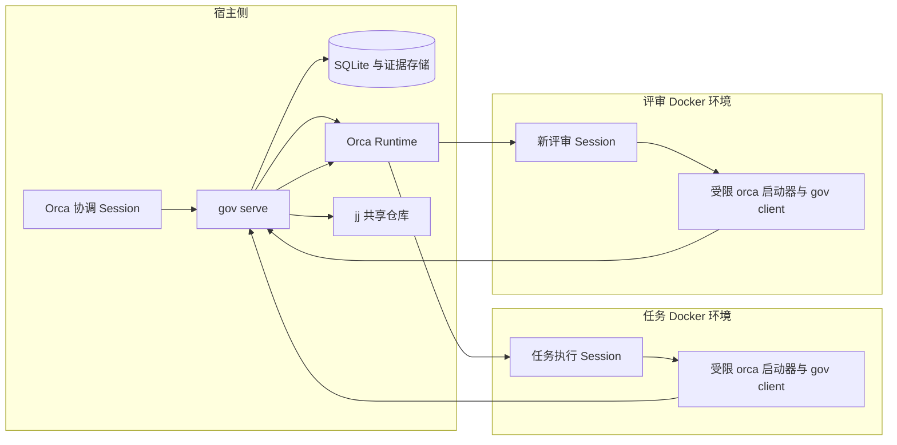
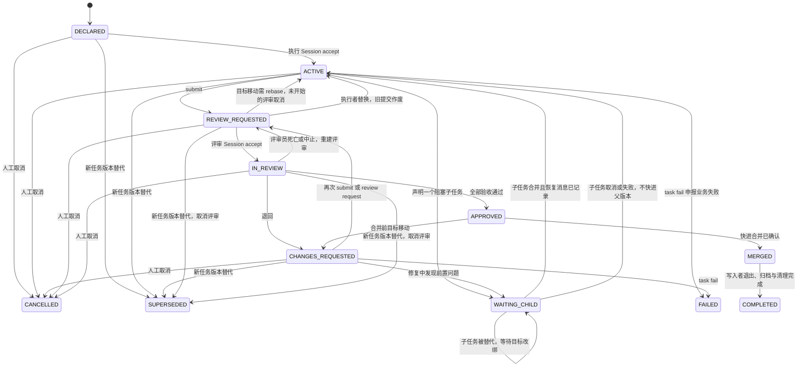

# Orca 多 Agent 治理代理技术设计

> 版本：v0.4（colocated 工作区修订：T0.2 实证纯 jj 注册两入口皆败，任务工作区改为 .jj 与 .git 并存的 colocated 仓）  
> 日期：2026-11-07  
> 实施计划：[governance-tasks.md](./governance-tasks.md)  
> 核查基线：Orca 1.4.238、jj 0.41.0、Node.js 24.15.0、pnpm 10.33.2、Docker 29.6.1

## 0. 摘要

目标工作方式来自一套已经在 DSH 中运行的三级多 Agent 流程：协调 Session 管理任务和并行预算，独立任务执行 Session 组织开发，开发 subagent 修改代码，独立评审 Session 验收并签核。任务具有父子结构，认领后独占工作区，版本操作只能经过授权入口。

Orca 已提供独立 Session、定向消息、Task/Dispatch、执行尝试失效隔离、工作区和一次性环境生命周期。当前缺口是：工作区没有排他写入权限，Task 完成不等于治理签核，验收证据没有固定结构，评审身份没有角色检查，jj 没有原生集成，worker 可以直接调用 Orca 管理命令。

本设计新增一个宿主侧治理代理 `gov`。它使用 Node.js 内置 SQLite 保存任务状态、认领、验收和合并记录，通过 Orca CLI 管理 Session，通过 jj 管理工作区。任务环境只提供受限 `orca` 启动器和 `gov` 客户端。启动器先向 `gov` 请求授权，再在原 worker 终端内以独立系统用户启动真实 Orca CLI；Agent 不能直接读取该用户的凭据或调用其二进制。首个受控版本使用本地 Docker 的 SSH-mode 环境，不接入云资源，不自动推送，不引入 Nix。

## 1. 已确认事实与设计推论

### 1.1 本机核查事实

1. Orca 1.4.238 正在运行，`agents-impl` 已注册。
2. Orca 支持 Session 全文搜索、独立 Agent 启动、定向消息、Task 父子字段、依赖检查、Dispatch 失效隔离、worker release 和环境 recipe；CLI 命令面包含 `run-use` 与 `worker-read`，其恢复行为由集成测试验证。
3. Orca Task spec 创建后没有修改入口；`task-update` 只暴露状态和结果，结果可由协调者手工改写。
4. Orca `worker_done` 会结算对应 Task；`merge_ready` 只是消息，不结算 Task。
5. Orca 内建 worktree 使用 Git。任意目录可作为 folder workspace，但纯 jj 目录的注册、启动和删除仍需实测。
6. Orca 没有为本地 worker 提供命令白名单或工作区写入隔离。
7. Node.js 24.15.0 的 `node:sqlite` 和 `node:util.parseArgs` 已在本机通过探针；jj 0.41.0 与 Docker 29.6.1 可用。
8. 本机未找到 Nix 命令。现有 `orca-dev-workflow` 只有 runbook 和历史问题报告，没有既有实现。
9. T0.2 探针（2026-11-07）：纯 jj 目录经 `repo add` 被拒（`Not a valid git repository`）；`project setup-existing-folder` 通道在 1.4.238 无可用的新文件夹建档命令，现存 folder project 均为旧版遗留。结论：纯 jj 工作区不可行，改用 colocated jj（D21）。

### 1.2 官方文档约束

1. Claude Code 的 Bash 权限规则不匹配所有间接调用，不能作为程序级安全边界；文件规则也不能限制所有子进程。
2. Claude Code 沙箱只覆盖部分工具。要把整个 Agent 进程置于同一边界内，需要容器、虚拟机或等价运行环境。
3. jj workspace 共享仓库和操作日志，但不提供工作区级写入权限。
4. jj 冲突会被记录为冲突对象，不按「后来者优先」处理。
5. jj bookmark 会随历史改写移动，不能作为任务起点的固定标识。
6. Nix 使用共享 store，全局垃圾回收不属于单任务清理。

### 1.3 设计推论

1. Orca 可以继续承担 Session 和 Dispatch 管理，但治理状态不能只依据 Orca Task 状态判定。
2. 认领、评审和合并必须由宿主侧治理代理检查，worker 的提示词不能代替这些检查。
3. Agent 不能直接执行通用 Orca CLI；否则 worker 可以调用 `task-update`、`worker-start` 或低层 dispatch 入口。
4. 评审需要独立 Session 和独立工作区。只更换 Dispatch、继续复用原终端，不满足「干净上下文」。
5. 所有外部副作用都需要持久操作记录；结果不确定时不能自动重复执行。

## 2. 目标与非目标

### 2.1 首个版本目标

1. 一个仓库内运行多个独立任务，每个任务只有一个有效写入认领。
2. 记录任务声明者、所有认领者、每次评审者和最终签核者。
3. 声明者和任何历史认领者都不能签核该任务。
4. 任务书包含问题、范围、外延、非目标、允许修改路径、目标分支和逐项验收标准。
5. 开发提交后由新评审 Session 在独立工作区复验。
6. 签核绑定精确 commit ID 和 tree ID；代码变化后旧签核失效。
7. 目标分支只接受快进合并；目标前进后必须 rebase 并重新验收。
8. 支持一个阻塞子任务的兔子洞流程，子任务完成后恢复父任务。
9. 合并确认、写入者退出和证据归档后，自动清理 Session、环境与 jj workspace。
10. 任务环境不能直接调用通用 Orca 管理命令、git 或 jj，也不能写其他任务目录。
11. 所有外部操作可恢复、可审计，结果不确定时停止自动推进。

### 2.2 首个版本不做

1. 不自动 push、创建 MR、部署或修改 GitLab Issue 状态。
2. 不接入云端 VM、远程服务器或多宿主调度。
3. 不支持一个父任务同时等待多个子任务。
4. 不支持自动冲突解决、非快进合并或自动 rebase 后直接签核。
5. 不提供模型自动路由、任务中切换模型或跨供应商重试。
6. 不开发新的 Web 面板；状态通过 `gov status` 和 Orca 现有界面查看。
7. 不引入 MCP 服务。CLI 是 Claude、Codex、OpenCode 等执行端的共同入口。
8. 不在核心流程中引入 Nix；Nix 作为后续环境改进单独验收。
9. 不让视觉、设备或跨系统任务自动签核；这些任务必须带人工验收记录。

## 3. 决策表

| 编号 | 决策 | 理由 |
|---|---|---|
| D1 | 保留 Orca 的 Session、Dispatch、消息和环境管理 | 避免重建已有协调能力 |
| D2 | `gov` 是治理状态唯一判定者 | Orca Task 结果可被手工修改，且没有签核角色 |
| D3 | 使用单一 Node.js 包提供服务端、客户端和受限启动器 | 减少跨语言接口和部署组件 |
| D4 | 使用 Node.js 内置 SQLite，只有 `gov serve` 写数据库 | 单写入者便于事务、恢复和测试 |
| D5 | Dispatch ID 是认领代次标识，认领还需执行 Session `accept` | 区分「已启动」与「执行者已接受」 |
| D6 | 开发完成发送 `merge_ready`，合并后才允许正常 `worker_done` | 防止开发完成提前结算原 Task |
| D7 | 每次提交都创建新评审 Session 和评审工作区 | 满足独立上下文和独立复验 |
| D8 | 验收绑定 commit ID 与 tree ID | change ID 在历史改写后仍可能保持不变 |
| D9 | 只允许目标未移动时的快进合并 | 合入结果与已验收结果保持一致 |
| D10 | 父任务等待子任务时禁止写入，第一版只允许一个活动子任务 | 避免父版本在子任务执行期间分叉 |
| D11 | 受控运行使用本地 Docker SSH-mode；受限启动器在 worker 原终端内启动真实 Orca CLI | 宿主负责授权，worker 的 Dispatch 身份仍由 Orca 在原终端中解析 |
| D12 | 目录删除由 Orca 环境生命周期执行，jj 负责注销 workspace | 避免两个系统同时删除同一目录 |
| D13 | Nix 延后，自动推送延后 | 首轮只验证任务治理和本地隔离 |
| D14 | 父子依赖由 `gov` 判断，正常流程不调用 `task-update` | 避免旧 runbook 手工推进状态或覆写结果 |
| D15 | 开发评审期间和父任务等待子任务期间暂停原环境 | 从进程和文件系统层面阻止等待期间写入 |
| D16 | 任务状态机以完整迁移表定义全部出口与入口，含失败、取消、替代与评审中止 | 终审七处死路均源于只建模主路径 |
| D17 | 角色禁令区分机制强制与流程约束；认领激活前工作区只读；治理存储归独立宿主用户 | 终审权限包：不可执行的承诺必须降级为流程级或补机制 |
| D18 | 资源清理按资源记账，不依赖任务结局 | 终审清理包：退回轮与被替代任务的资源也要有销毁路径 |
| D19 | 人工验收凭宿主侧操作员回执，容器侧不可伪造 | 终审人工验收核验：gate-resolve 不构成人工批准 |
| D20 | worker 替换先经 worker-stop / worker-abandon 结算，重派走 retry-of | 终审 Orca 结算合同：未结算的 Dispatch 无法重派 |
| D21 | 任务工作区使用 colocated jj 仓（`.jj` 与 `.git` 并存）；容器内保护对象为 `.jj` 与 `.git` 两个目录 | T0.2 实证纯 jj 目录被 `repo add` 拒收且 1.4.238 无 folder 建档命令（见 `probes/orca-jj-folder.md`）；colocated 仓是合法 Git 仓，可直接注册（T0.2b 验证） |

## 4. 角色与身份

| 角色 | 允许操作 | 明确禁止 | 强制层级 |
|---|---|---|---|
| 协调 Session | 声明顶层任务、创建执行 Session、处理预算和异常 | 修改任务代码、代替评审签核、直接写治理存储 | 流程：宿主侧与 gov 同信任域，治理存储由独立用户与 API 边界保护（§5.1） |
| 任务执行 Session | 接受认领、组织开发、声明子任务、提交验收、申报失败、根据退回意见继续 | 签核、合并、调用通用 Orca 管理命令、直接运行 git/jj | 机制：gov 无对应授权动词；启动器拒绝管理命令；容器内无 git/jj |
| 开发执行者 | 修改允许路径、运行测试、报告结果 | 修改任务状态、认领其他任务、操作其他工作区 | 修改任务状态为流程级（与执行者同容器同信任域）；跨任务目录为机制级 |
| 评审 Session | 接受评审、复验、提交通过或退回结论 | 篡改被审版本、合并、复用开发 Session 身份 | 机制：评审结论绑定评审 tree；历史认领者无法取得评审令牌 |
| 人工操作员 | 签发人工验收回执、处理范围变化、结果不确定和特殊授权、取消任务 | 无；所有操作仍记录回执 | — |

身份由宿主侧 Orca 启动回执、Dispatch ID、终端句柄和 `caller.orcaSessionId` 共同确定。客户端提交的 `session_id` 只作交叉检查，不能作为身份来源。

「Dispatch 身份来源」指 Orca 根据调用终端、Dispatch 和启动回执判定消息属于哪个执行尝试的过程。「worker 注入指令」指 Orca 启动 worker 时写入终端的任务与命令文本；它不是启动器的授权输入。「受限启动器」是任务环境内唯一可调用真实 Orca CLI 的入口，它从 `gov` 取得身份和允许动作，不接受 Agent 替换这些字段。

每次认领先生成保留记录，再创建环境和 Session。执行 Session 使用本次认领令牌调用 `accept` 后，认领才进入活动状态。任何历史认领 Session 都不能成为该任务评审者，即使它获得了新的 Dispatch。

## 5. 总体结构

### 5.1 信任边界

1. `gov serve`、SQLite 和 jj 共享仓库只存在于宿主侧，并归独立宿主用户所有；协调 Session 以普通用户运行，只能经 `gov` 的宿主 API 访问治理数据，不能直接读写数据库或 jj 仓库。
2. 任务工作区在认领激活前以只读方式挂载；`task accept` 成功后由 `gov` 切换为可写，切换失败则认领回退并转人工。
2. 协调 Session 可以请求声明和分派，但不能直接写治理结果。
3. 任务环境只挂载本任务工作区、受限客户端和临时构建目录。
4. 评审环境只包含被审版本的独立工作区，不包含开发工作区写权限。
5. 任务令牌按认领或评审发放，限定任务、Dispatch、允许动作和有效期；令牌只保存在 `orca-broker` 用户的配置中，不写入 Agent 环境。
6. 任务环境内的真实 Orca CLI 和配对信息归独立 `orca-broker` 系统用户所有，Agent 用户不能读取或执行。
7. Agent 只能调用 root 所有的受限启动器。启动器通过 `sudo` 以 `orca-broker` 身份运行，先向 `gov` 校验动作，再在 worker 原终端中启动真实 CLI。
8. 受控运行时，宿主 `gov` 不代替 worker 发送生命周期消息，避免丢失 Dispatch 身份来源。Track A 开发测试可由 Orca 适配层模拟消息，但不得作为受控运行证据。
9. 任务环境没有宿主机 SSH 密钥、Git 远端凭据、Docker socket 或其他任务目录。
10. 验证命令只在任务或评审环境执行，宿主不执行模型提供的 shell 文本。

### 5.2 技术选型

1. Node.js 24 LTS、TypeScript 严格模式、pnpm 锁定依赖。
2. `node:sqlite` 保存状态，`node:util.parseArgs` 解析 CLI，`node:http` 提供宿主专用 JSON API。
3. Zod 校验外部输入、Orca JSON 和证据文件；未知字段默认拒绝。
4. `node:test` 运行单元和集成测试，不新增测试框架。
5. 本地 Docker SSH-mode 承载受控 worker；宿主专用 API 不暴露到公网。

## 6. 数据设计

### 6.1 不可变任务书

| 字段 | 含义 |
|---|---|
| `schema_version` / `task_id` | 接口版本与治理任务 ID |
| `problem` | 需要解决的问题 |
| `in_scope` / `out_of_scope` / `non_goals` | 任务内含、外延与非目标 |
| `owned_paths` | 允许修改的仓库相对路径；首版必须非空 |
| `repo_id` | `gov` 配置中的仓库 ID，不接受任意宿主路径 |
| `target_kind` / `target_id` | 顶层目标 bookmark 或父任务认领 ID |
| `base_commit_id` | 创建时固定的起点 commit |
| `acceptance_criteria[]` | 有序验收标准 |
| `parent_task_id` / `supersedes_task_id` | 兔子洞父任务或替代的旧任务版本 |
| `agent_policy` | 已配置的执行与评审 Agent 名称，不允许任意模型参数 |
| `budget` | 时间、评审轮数和输出大小上限 |

任务书经规范化后计算 `spec_hash`，完整内容存入治理数据库，摘要和哈希写入 Orca Task spec。任务书不能原地修改；范围变化需要新任务版本，旧任务标记为 `SUPERSEDED`。

### 6.2 核心记录

| 记录 | 关键字段与约束 |
|---|---|
| `tasks` | Orca Task ID、spec hash、业务状态、阻塞原因、当前认领、父任务、目标、评审版本、合并版本 |
| `acceptance_criteria` | 任务 ID、criterion ID、验证类型、验证配置、是否要求人工验收 |
| `claims` | 认领 ID、任务、Dispatch、claimer Session、终端、工作区、状态；同一任务最多一个非终态认领 |
| `workspaces` | jj workspace 名、宿主路径、环境实例、环境状态、base commit、清理状态；环境状态区分运行、暂停、删除中和结果不确定 |
| `submissions` | 认领、提交版本、tree ID、开发证据清单哈希、提交时间；认领与版本组合唯一 |
| `reviews` | 提交、评审 Dispatch、评审 Session、评审工作区、结论、报告、评审版本 |
| `findings` | 来源评审、关联提交、严重度、状态、说明、不处理理由、解决版本；状态包括 `OPEN`、`PARKED`、`RESOLVED` |
| `evidence` | criterion ID、提交或评审 ID、版本、产物路径、内容哈希、退出码、产生者、人工决策 ID |
| `operations` | 操作类型、请求 ID、请求哈希、状态、当前步骤、外部 ID、回执、安全错误码 |
| `events` | 单调序号、任务、事件类型、操作者、时间、大小受限的载荷与载荷哈希 |
| `capabilities` | 令牌哈希、角色、任务、认领或评审、允许动作、到期时间、撤销时间；不保存明文令牌 |

### 6.3 验收标准类型

| 类型 | 执行位置 | 可接受证据 |
|---|---|---|
| `command` | 评审环境的独立工作区 | 退出码、命令配置哈希、日志哈希、版本 |
| `artifact` | 任务或评审环境 | 文件哈希、生成者、版本、大小与路径检查 |
| `manual` | 人工操作员 | 宿主侧 `manual approve` 回执（验收标准、操作者、时间），必要时附图片或设备记录；容器侧不可伪造，`gate-resolve` 不构成人工验收 |

开发证据用于说明工作过程，评审证据用于签核。只有开发证据、没有评审证据，不能通过。

## 7. 状态设计

### 7.1 任务状态

完整迁移表（每条迁移含触发者与环境动作；未列出的迁移一律非法，`T1.2` 拒绝写入）：

| 当前状态 | 事件 | 目标 | 环境与资源动作 |
|---|---|---|---|
| DECLARED | 执行 Session accept | ACTIVE | 工作区由只读切换为可写 |
| DECLARED | 人工取消 | CANCELLED | 结算未接受的 Dispatch，销毁已创建但未激活的环境与工作区 |
| DECLARED | 新任务版本替代 | SUPERSEDED | 结算未接受的 Dispatch，销毁已创建但未激活的环境与工作区 |
| ACTIVE | submit | REVIEW_REQUESTED | 记录版本；等待 merge_ready 后暂停开发环境 |
| ACTIVE | task fail | FAILED | 确认后允许 worker_done --outcome failed；按 §8.6 清理 |
| CHANGES_REQUESTED | task fail | FAILED | 同 ACTIVE 的失败动作 |
| ACTIVE | task split | WAITING_CHILD | 固定父版本，暂停父环境，创建子任务 |
| ACTIVE / CHANGES_REQUESTED / REVIEW_REQUESTED / IN_REVIEW | 人工取消 | CANCELLED | 在飞的评审取消并销毁评审资源；结算 Dispatch 后按 §8.6 清理 |
| ACTIVE / CHANGES_REQUESTED / REVIEW_REQUESTED / IN_REVIEW | 新任务版本替代 | SUPERSEDED | 已启动的评审取消并销毁评审资源；按 §8.6 清理 |
| WAITING_CHILD | 子任务合并且恢复消息已记录 | ACTIVE | 快进父版本，确认 tree 后恢复父环境 |
| WAITING_CHILD | 子任务取消或失败 | ACTIVE | 不快进父版本；确认 tree 后恢复父环境，由父执行者自行处理 |
| WAITING_CHILD | 子任务被替代 | WAITING_CHILD | 等待目标改绑替代任务，恢复条件沿用 |
| CHANGES_REQUESTED | 再次 submit（新版本） | REVIEW_REQUESTED | 记录新版本，旧证据作废 |
| CHANGES_REQUESTED | review request（同版本补证据） | REVIEW_REQUESTED | 复用版本，消耗评审轮数预算 |
| CHANGES_REQUESTED | task split | WAITING_CHILD | 同 ACTIVE 的 split 动作 |
| REVIEW_REQUESTED | 评审 Session accept | IN_REVIEW | 评审环境与工作区已在进入 REVIEW_REQUESTED 时创建；accept 仅激活评审 |
| REVIEW_REQUESTED | 目标移动需 rebase | ACTIVE | 取消未开始的评审；恢复开发环境执行 rebase |
| REVIEW_REQUESTED | 执行者替换（结算旧 Dispatch 后） | ACTIVE | 取消并结算未开始的评审 Dispatch，销毁评审资源；旧提交作废；新执行者在保留的工作区上重新提交 |
| IN_REVIEW | 退回 | CHANGES_REQUESTED | 销毁评审资源；tree 确认后恢复开发环境 |
| IN_REVIEW | 评审员死亡或中止 | REVIEW_REQUESTED | 销毁评审资源；重建评审环境与新评审 Session |
| IN_REVIEW | 全部验收通过 | APPROVED | 销毁评审资源 |
| APPROVED | 快进合并已确认 | MERGED | 合并读回确认；恢复开发环境允许最终 worker_done |
| APPROVED | 合并前目标移动 | CHANGES_REQUESTED | 旧签核失效；恢复开发环境 |
| MERGED | 写入者退出、归档与清理完成 | COMPLETED | 按 §8.4 收尾 |

`FAILED`、`CANCELLED` 只表示明确的业务终止。平台超时、Orca 连接中断或合并结果不确定使用 `blocked_reason` 和操作状态表示，不直接改写为业务失败。

### 7.2 认领状态

| 状态 | 含义 |
|---|---|
| `PREPARING` | 已保留任务，正在创建工作区、环境或 Session |
| `DISPATCHED` | Dispatch 已创建，等待执行 Session `accept` |
| `ACTIVE` | 当前唯一有效写入认领 |
| `FENCED` | 已被新认领替代，不能继续提交 |
| `RELEASED` | 已正常释放 |
| `UNCERTAIN` | 外部状态未确认，禁止创建替代写入者 |

### 7.3 外部操作状态

`PREPARED → IN_FLIGHT → CONFIRMED` 是成功路径。调用失败进入 `FAILED`；超时、进程退出或传输中断但无法确定外部结果时进入 `UNCERTAIN`。只有查明外部事实后才能继续，不能从 `UNCERTAIN` 自动重试。

## 8. 核心流程

### 8.1 声明与认领

1. 协调 Session 调用 `task declare`。`gov` 校验仓库允许清单、路径范围、目标 bookmark、base commit 和验收标准。
2. `gov` 创建不可变任务书和可分派的 Orca Task，记录声明者身份。父子依赖保存在治理数据库；只有依赖已满足的 Task 才进入 Orca，不使用 `task-update` 手工推进。
3. 协调 Session 请求创建执行 Session。数据库先保留认领，防止并发重复创建。
4. `gov` 创建 jj workspace 和任务环境，记录每一步回执。
5. `gov` 通过 Orca 启动监督式 worker，取得 Dispatch、终端和 Session 身份。
6. 执行 Session 阅读任务书并调用 `accept`。`gov` 核对 Dispatch 后激活认领。
7. 任一步骤失败时，保留操作记录和残余资源信息；没有查明前不允许第二次认领。

### 8.2 开发提交与评审

1. 执行 Session 完成开发后调用 `task submit`。
2. `gov` 在宿主侧执行 jj snapshot，检查允许修改路径，记录 commit ID 和 tree ID。
3. `gov` 检查目标是否仍等于提交时预期位置；目标已移动则要求 rebase。
4. `task submit` 受理后立即返回回执（提交号、版本、tree ID），不阻塞等待评审结果。执行 Session 随后经受限启动器发送 `merge_ready`（Orca 动作，因对应提交已存在而获得授权），原 Orca Task 保持未结算。
5. `gov` 从 Run 邮箱确认 `merge_ready` 后，撤销本次认领的写动作并暂停任务环境。暂停失败时不启动评审。
6. `gov` 创建独立评审工作区和评审 Session。评审者不得是声明者或任何历史认领者。
7. 评审者逐项复验。验证命令使用任务书中的配置，在评审环境运行。
8. 评审结束后检查评审工作区中受版本控制的 tree 是否仍等于被审 tree；发生变化则本次评审无效。
9. 评审 Session 提交结论、问题记录和证据。评审任务本身以「评审工作已完成」结算，与「开发任务通过」是两个不同结果。
10. 退回时，`gov` 先确认暂停中的工作副本 tree 仍等于提交 tree。若不一致，进入 `WORKSPACE_DIVERGED` 并转人工，不恢复写入；若一致，恢复原任务环境，再向原认领 Dispatch 发送定向消息，原执行 Session 继续修改。
11. 每次重新提交都创建新评审 Session。任务级评审轮数、时间和产物大小在签核前检查，超出上限时拒绝签核并转人工；恰好用满上限且评审通过的，正常签核。
12. 退回理由不含代码缺陷（仅证据或流程问题）时，执行 Session 可调用 `review request` 对同一版本补充证据重新送审；该动作消耗评审轮数预算，且必须附补充证据。`task submit` 仍只接受新版本。

`task submit` 是持久操作：受理即产生提交号，连接中断后用原请求 ID 查询受理结果，不创建重复提交。评审结果不通过 submit 返回——环境暂停前 submit 已返回；执行 Session 通过 `task status` 轮询，或在环境恢复时收到携带结论的定向消息。环境暂停必须保留进程状态，使原 worker 能在恢复后继续其终端上下文。

### 8.3 签核条件

以下条件必须同时成立：

1. 评审 Dispatch 与本次提交匹配，评审 Session 是本次新启动的独立 Session。
2. 评审者不属于任务声明者或任何历史认领者。
3. 提交版本、评审版本和当前认领版本完全一致。
4. 每条验收标准都有有效评审证据；人工标准已有解决的人工决策记录。
5. 所有改动都在 `owned_paths` 内。
6. 没有状态为 `OPEN` 的中高严重度问题；低严重度问题必须为 `PARKED` 或 `RESOLVED`，并记录理由和解决版本。
7. 目标当前位置与本次验收时记录的位置一致。
8. 评审轮数、时间和产物大小没有超过预算。

### 8.4 合并与清理

1. `gov` 按目标 bookmark 串行执行合并。
2. 合并前再次比较目标、提交版本和 tree ID，只允许快进。
3. 合并后读取 bookmark 和 op log，确认预期结果，再写入 `MERGED`。
4. 正常路径在恢复原任务环境前，再次确认工作副本 tree 等于提交 tree；不一致时进入 `WORKSPACE_DIVERGED`，不恢复写入、不清理，已确认合并不自动回滚。确认一致后恢复环境，允许原 worker 发送最终 `worker_done`，随后执行 Orca release。
5. worker 已消失时，`gov` 先经 `worker-stop` 结算 Dispatch（结果不确定时取得正面退出证明后 `worker-abandon`），再继续收尾；不能伪造 `worker_done`。
6. 证据和审计记录归档到工作区之外。
7. Orca 执行 worktree/environment 删除并确认目录已清理。
8. `gov` 再执行 `jj workspace forget`，移除仓库对该工作区的跟踪。
9. 清理失败进入 `cleanup_pending`，不改变已确认合并事实，也不重新打开开发任务。

### 8.5 兔子洞父子任务

1. 父任务执行 Session 发现必须先解决的问题，调用 `task split` 提交完整子任务书。
2. `gov` 固定父任务当前版本，撤销父认领写动作并暂停父任务环境。暂停失败时不创建子任务。
3. 子任务必须属于同一仓库，`owned_paths` 必须是父任务允许路径的子集；超出父范围的问题应创建顶层任务或新父任务版本。
4. 子任务以父任务当前认领为目标，以父版本为 base，拥有独立认领、工作区和评审，不继承父任务的签核权限。
5. 子任务签核后只快进父任务版本，不直接修改顶层目标 bookmark。
6. `gov` 更新父工作区前先比较实际 tree 与锁定 tree；出现额外改动时进入 `PARENT_WORKSPACE_DIVERGED`，不得覆盖，转人工处理。
7. 父工作区确认一致后，`gov` 恢复父环境并记录父任务恢复事件。父任务消息采用至少一次投递；父任务以 `parent_revision` 幂等处理，重复消息不能产生重复修改。
8. 父任务等待期间不能替换认领。父 Session 无法恢复时，先完成或取消子任务，再按恢复流程处理父认领。
9. 子任务失败或被取消时，父任务回到 ACTIVE 但不快进父版本；父执行者需自行处理原问题或再次拆分。恢复前的 tree 一致性检查与合并路径相同。
10. 父任务恢复后必须检查子任务结果和自身验收标准，不能直接签核父任务。

`task split` 使用与 `task submit` 相同的持久请求语义。父环境恢复后，原请求返回子任务摘要、已合入的 `parent_revision` 和「返回父任务继续处理」的明确指令；连接中断时查询同一请求，不能重复创建子任务。

### 8.6 资源清理合同

清理按资源记账，不依赖任务结局。每项资源（任务环境、评审环境、工作区、Session、Dispatch）在创建时登记清理责任，销毁条件如下：

| 资源 | 销毁时机 |
|---|---|
| 评审环境与评审工作区 | 有结论的路径：结论受理且评审 Dispatch 结算（worker_done 或 release 回执）后销毁。中止路径（评审员死亡、任务取消或被替代）：对应 Dispatch 经 stop / abandon 结算后即可销毁，无需结论。退回后的下一轮提交前必须确认已销毁 |
| 失败或取消任务的全部资源 | `task fail` / 人工取消的结算回执与证据归档完成后 |
| 被替代任务的全部资源 | SUPERSEDED 迁移与归档完成后；在飞的评审同时取消并销毁 |
| 正常路径资源 | 按 §8.4：合并确认、写入者退出、归档完成后 |

清理失败进入 `cleanup_pending`，不改变已确认的结算或合并事实。清理回执按资源记录，可与外部操作状态分别重试。

## 9. 对外接口

### 9.1 `gov` 客户端

| 命令 | 调用角色 | 结果 |
|---|---|---|
| `serve` / `doctor` | 人工操作员 | 启动宿主服务或检查版本、路径、Orca、jj、Docker |
| `task declare` | 协调 Session | 创建不可变任务书与 Orca Task |
| `task claim` | 协调 Session | 保留认领并创建执行环境、Session |
| `task accept` | 任务执行 Session | 激活本次认领 |
| `task submit` | 任务执行 Session | 固定版本、提交证据并申请评审 |
| `task split` | 任务执行 Session | 创建子任务并暂停父任务 |
| `task rebase` | 任务执行 Session | 请求宿主 rebase；成功或冲突都产生新版本 |
| `task status` | 所有已授权角色 | 返回状态、阻塞原因和下一步 |
| `task fail` | 任务执行 Session | 申报业务失败；确认后允许 `worker_done --outcome failed` 并按 §8.6 触发清理 |
| `review request` | 任务执行 Session | 对同一版本补充证据重新送审（仅限证据类退回） |
| `task cancel` | 人工操作员 | 取消任务并按 §8.6 销毁资源 |
| `manual approve` | 人工操作员 | 在宿主侧签发人工验收回执，绑定验收标准、操作者与时间；容器侧不可伪造 |
| `review accept` | 评审 Session | 接受本次独立评审 |
| `review submit` | 评审 Session | 提交逐项证据和结论 |
| `operation show` / `operation resume` | 人工操作员 | 查看或恢复已查明的外部操作 |

所有修改请求都带请求 ID。同一请求 ID 携带不同请求哈希时拒绝执行。服务端还按业务唯一键去重：一个认领只能提交同一版本一次，一个评审只能结算一次，一个提交只能合并一次，一个清理步骤只能确认一次。

任务与评审环境内的 `gov` 客户端也通过受限启动器调用。认领和评审令牌只保存在 `orca-broker` 用户配置中，不写入 Agent 的环境变量或可读文件。

### 9.2 受限启动器

任务环境内的 `orca` 入口指向 root 所有的受限启动器。启动器通过 `sudo` 以 `orca-broker` 身份运行；`sudoers` 只允许这一固定入口，不允许 Agent 以该用户执行其他程序。启动器完成以下步骤：

1. 根据调用进程的系统用户、容器实例和 `orca-broker` 持有的令牌，从 `gov` 反查绑定到该容器实例的当前认领或评审（含等待接受的状态），取得任务、终端、Dispatch 和角色。Agent 传入的 worker 注入指令和身份字段一律不作为授权输入。
2. 向 `gov` 提交规范化后的动作和参数，取得一次授权编号。
3. 对 `gov` 动作，只允许当前角色在 §9.1 中可用的任务接口：执行 Session 的 `task accept`、`submit`、`fail`、`split`、`rebase`、`review request`、`status`，以及评审 Session 的 `review accept`、`review submit`、`status`。`declare`、`claim` 和人工恢复接口不在任务或评审环境开放。
4. 对 `gov` 动作，启动器将请求交给 `gov` 执行并返回结果，不启动 Orca CLI，也不增加第二个 sudo 入口。
5. 对 Orca 动作，仅允许 `status --json` 的受限身份读取，以及当前 Dispatch 的 `orchestration check`、`ask`、`reply`、`send`。启动器在 worker 原终端中启动真实 Orca CLI，使用 `gov` 返回的原始终端和 Dispatch 参数，使 Orca 继续按原 worker 解析身份来源。真实 CLI 的工作目录固定为 broker 专用的空目录，不读取任务仓库配置、任务内 Node 模块或 Agent 环境变量；worker 注入指令只用于核对显示，不参与授权。
6. 将 `gov` 或真实 CLI 的退出码和结构化结果原样返回，并写入不含凭据的回执。

消息限制：

1. `merge_ready` 只能在 `task submit` 成功后发送。
2. 开发任务的 `worker_done` 只能在合并确认后发送，或在 `task fail` 确认后以 `--outcome failed` 发送；评审任务的 `worker_done` 只能在 `review submit` 被接受后发送，只表示评审工作结束。
3. 禁止组地址、任意 recipient、任意 Task/Dispatch ID 和自定义 lifecycle 参数。
4. 禁止 `task-update`、`worker-start`、`dispatch`、`worktree`、`repo`、`terminal`、`automations` 及其他管理命令。
5. 启动器不接受任意宿主路径、shell 文本或原始 Orca 参数透传。

受限启动器的可注入性、独立用户权限和原终端身份来源是实施前置验证项。若 Orca 不能把注入 executable 指向启动器，或经启动器执行时不能保留原 Dispatch 身份，受控版本停止实施并转入 Orca 能力修改，不得向 Agent 开放通用 CLI。

### 9.3 Session 管理

协调 Session 使用宿主 Orca 的 `search`、`worker-read` 和 `terminal read`。默认只检索相关片段和最终报告，完整转写记录仅在排障时读取。任务执行 Session 和评审 Session 不使用这些跨 Session 读取能力。

独立任务执行 Session 只能由 `task claim` 创建，独立评审 Session 只能由提交流程创建。二者都不是协调 Session 或任务执行 Session 的引擎内 subagent。定向消息只发送到当前 Dispatch，不使用组地址。

## 10. jj 版本规则

1. 顶层任务以目标 bookmark 当时的 commit 为 base；子任务以父任务锁定版本为 base。
2. bookmark 只表示合并目标，不能代替 base commit。
3. 每次提交同时记录 commit ID 和 tree ID。
4. `gov` 独占 snapshot、rebase、bookmark 移动、workspace 注销。
5. 目标在验收前移动：要求 rebase，尚未开始的评审取消。
6. 目标在签核后、合并前移动：旧签核失效，回到 `CHANGES_REQUESTED`。
7. `task rebase` 由 `gov` 执行并产生新操作记录。无论成功或冲突，旧提交、评审和证据都不得用于新版本。
8. rebase 产生冲突时，任务执行 Session 只编辑冲突文件，然后再次调用 `task submit`。`gov` 在 submit 时 snapshot，并确认 jj 不再报告冲突；仍有冲突则拒绝提交。解决后的新 commit 和 tree 必须重新评审。
9. rebase 成功但没有冲突时，也必须由任务执行 Session 重新运行检查并提交，不能沿用旧签核。
10. 合并按目标串行，外部移动导致结果不一致时进入 `MERGE_UNCERTAIN`，不清理工作区。
11. 评审工作区与被审 commit 绑定，不跟随任务 bookmark。

## 11. 环境、资源与 Nix 演进

### 11.1 首个受控环境

1. 使用本地 Docker SSH-mode，宿主 Orca 通过 SSH 管理终端，容器内不运行 Orca server。
2. 容器只挂载本任务目录和受限控制通道，使用非 root 用户运行 Agent。环境 suspend/resume 必须保留容器和进程状态，不能通过销毁重建模拟暂停。
3. 真实 Orca CLI、配对信息和受限启动器由 root 或 `orca-broker` 用户持有；`sudoers` 只允许 Agent 调用固定启动器，且禁止环境变量继承和参数中的 shell 展开。镜像移除其他不需要的 setuid/setgid 可执行文件，sudo 配置只存在于测试容器，不修改宿主配置。
4. `.jj`、`.git` 在容器内由 root 持有，宿主 `gov` 独占 jj 操作；任务用户不能读取、修改、重命名或删除这些目录。
5. 宿主不挂载 Docker socket、个人配置目录、版本管理凭据或其他任务目录。
6. 每个容器配置 CPU、内存、进程数和磁盘上限；全局构建并发单独限制。
7. 控制通道只允许访问 `gov` 的任务 API，不允许 Agent 直接访问通用 Orca 管理接口。
8. 文件路径、符号链接、归档大小和输出大小都在边界检查。

### 11.2 并行预算

任务级评审轮数、执行时间和证据大小在提交与签核流程中直接检查。跨任务预算配置为：两个活动任务、一个活动评审、一个构建任务。每个 Agent 供应商另设正在执行请求上限。达到上限时任务保持等待，不自动更换模型或供应商。其中任务与评审并发由 `gov` 在派发时强制；构建并发与供应商请求上限在 v0.3 为承诺级声明，尚无准入机制（已知缺口，延后处理，见任务计划 T6.2 备注）。

协调 Session 只接收状态变化、问题、人工决策请求和异常。普通进度不发送给人，完整转写记录只在排障时按需读取。

### 11.3 Nix 后续接入

1. Nix 只负责容器内开发工具和依赖，不承担文件权限或任务资源限制。
2. 环境 create 阶段进入 `nix develop`，destroy 阶段删除任务可写环境。
3. 如使用宿主共享 store，为每个任务建立独立 gc root；清理只删除该 root。
4. 不在任务清理中执行全局 `nix-collect-garbage -d`。
5. Nix 接入必须验证两个任务的环境互不影响，且删除一个任务不会删除另一个任务的运行依赖。

## 12. Skills、hooks 与角色提示词

### 12.1 Skills

复用 Orca 随附的 `orchestration`、`orca-cli`、`orca-per-workspace-env`。现有 `orca-coord` 在试点后改为调用 `gov`，不新增同义协调 skill。

### 12.2 Hooks

1. `SessionStart` 注入角色、任务 ID、任务书路径和停止条件。
2. `PreToolUse` 拦截明显的 git、jj 和 Orca 管理命令，记录违规尝试。
3. hooks 不作为认领、签核、合并或文件权限的判定者。
4. 受控环境不可用时拒绝启动，不能回退到宿主直接执行。

### 12.3 提示词合同

协调提示词只包含任务声明、预算和异常处理；任务执行提示词包含范围、子任务、提交后等待和禁止签核；开发提示词包含允许路径和实际测试；评审提示词包含独立复验、证据格式、版本绑定和禁止修改被审版本。

提示词不描述「模型应该很难绕过」，只说明可用接口。实际限制由 `gov` 和环境执行。

## 13. 恢复与审计

1. 数据库开启外键、WAL 和显式事务，只有 `gov serve` 写入；数据库事务中不调用 Orca、jj、Docker 或其他外部进程。
2. 每个外部调用前写入操作和请求哈希，调用后追加外部 ID、版本、耗时和回执。同一请求 ID 对应不同请求哈希时拒绝执行。
3. Orca 调用失败时读取 `failedStage` 和 `residualResources`，不直接重新启动。
4. Orca `worker-start` 结果不确定时，认领保持 `UNCERTAIN`，禁止第二个写入者。
5. jj 合并结果不确定时，先读取 bookmark、commit 和 op log，不能重复合并。
6. 环境 destroy 和 workspace forget 分开记录，可分别重试已确认未完成的步骤。
7. 审计日志只记录 ID、配置哈希、计数、耗时和安全错误码；凭据、环境变量和完整模型输出不进入日志。
8. 证据产物保存在工作区之外，路径和大小受限，读取时再次验证哈希。
9. `operation resume` 只接受人工查明后的恢复动作，不提供「忽略不确定状态继续」参数。
10. 协调 Session 需要替换时，新 Session 通过 Orca `run-use` 和 `gov status` 恢复；治理数据库不依赖协调上下文。
11. 任务执行 Session 需要替换时：取得旧 writer 已退出的明确证据 → `gov` 调用 `worker-stop` 结算旧 Dispatch（结果不确定时取得正面证明后用 `worker-abandon`）→ 旧认领标记为 `FENCED` 并撤销令牌 → 以 `worker-start --retry-of` 重派。新 Dispatch 接受后才能写入；旧提交和评审不能直接转移给新认领。
12. 父任务有活动子任务时不允许替换父认领，先处理子任务，避免子任务继续指向旧父版本。
13. 人工验收回执、`worker-stop` / `worker-abandon` / `retry-of` 回执与资源销毁回执均写入操作记录，与外部操作状态一并恢复。
14. 任务在 REVIEW_REQUESTED 状态替换执行者时：结算旧执行 Dispatch，取消并结算未开始的评审 Dispatch、销毁评审资源 → 任务回到 ACTIVE → 旧提交作废 → 新执行者在保留的工作区上重新提交。该状态下执行环境处于暂停，业务失败改由人工取消路径处理。

## 14. 测试与发布标准

### 14.1 确定性测试

1. 任务书缺少范围、非目标、路径或验收标准时拒绝创建。
2. 两个并发认领只有一个能进入活动状态。
3. 声明者、当前认领者和历史认领者都不能签核；同一 Session 更换 Dispatch 仍不能绕过。
4. 缺少任一评审证据、证据版本不符或评审 tree 被修改时拒绝签核。
5. 存在 `OPEN` 的中高严重度问题，或低严重度问题没有处理状态和理由时拒绝签核。
6. 目标移动、提交后修改、rebase 后沿用旧签核都被拒绝。
7. rebase 冲突只能由 worker 编辑文件；snapshot 后仍有冲突时拒绝提交，解决后使用新 Session 评审。
8. 任务级评审轮数、时间和证据大小超限时拒绝签核并转人工。
9. 开发评审和父任务等待期间环境处于暂停状态；恢复前发现额外写入时停止推进。
10. 重复提交、重复评审、重复恢复和重复清理不产生重复副作用。
11. 子任务恢复消息重复投递时，父任务效果保持幂等；子任务路径必须属于父任务范围。
12. 认领、评审、合并和清理在各个外部调用点中断后可恢复；协调或执行 Session 替换不产生第二个写入者。
13. 业务失败、人工取消、子任务取消、评审中止、同版本补证据重送和被替代任务都有合法迁移、结算回执与资源销毁回执；认领激活前对工作区的写入被拒绝。

### 14.2 隔离测试

1. 直接运行、绝对路径运行以及经 Python/Node 间接运行 git/jj，都不能修改仓库。
2. 直接写、重命名或删除 `.jj` / `.git` 都失败。
3. 写其他任务目录、宿主机目录和 Docker socket 都失败。
4. 调用通用 Orca 管理命令、组消息、伪造 Dispatch、伪造 worker 注入指令和越权 `gov` 动作都失败；其他 setuid/setgid 路径不能取得 broker 或 root 权限。
5. 提前 `worker_done` 被拦截，开发提交只能发送 `merge_ready`。
6. 容器达到内存、进程或磁盘上限时只影响当前任务，宿主和其他任务继续运行。

### 14.3 真实试点

1. 先在一个临时 jj 仓库完成全部确定性测试和隔离测试。
2. 再选择一个纯逻辑、已有自动测试的小任务，使用 OpenCode 开发、Claude 或 Codex 独立评审。
3. 完整记录声明、认领、提交、评审、合并、清理和残留资源计数。
4. 通过一次退回后继续、一次目标移动后重新验收和一次父子任务恢复。
5. 最后扩大到两个并行任务；首版不测试无人值守的视觉或跨系统任务。

### 14.4 完成定义

设计和 runbook 已同步；全部相关测试无跳过地通过；真实 Orca、jj、Docker 和至少一种真实 Agent 完成试点；认领、权限、恢复和清理均有回执；没有遗留进程、容器、工作区或未说明的外部副作用；没有自动推送或部署。

## 15. 前置验证与停止条件

以下三项属于实施阻塞项，不能用提示词或未验证假设代替：

1. ~~纯 jj 目录能否注册为 Orca folder workspace~~ 已验证：两注册入口皆败（`probes/orca-jj-folder.md`），按 D21 改用 colocated jj；替代验证为 T0.2b（colocated 仓的注册、启动与删除）。
2. Orca worker 注入的 executable 能否指向任务环境内的受限启动器；真实 CLI 经独立用户启动后能否保留原 worker 的 Dispatch 身份来源。
3. Docker 内非 root 任务用户能否在正常工作目录写入文件的同时，被阻止修改、重命名和删除 `.jj` / `.git`。

任一验证失败时，停止受控版本的后续实施，记录最小复现并修改对应平台能力。宿主直接运行通用 CLI 的模式只能用于开发测试，不能作为失败时的受控替代方案。

## 16. 参考资料

- 本机 Orca 1.4.238：`orca skills get orchestration`、`orca skills get orca-cli`、`orca skills get orca-per-workspace-env`
- 现有流程：[runbook.md](./runbook.md)
- [Claude Code Permissions](https://code.claude.com/docs/en/permissions.md)
- [Claude Code Sandboxing](https://code.claude.com/docs/en/sandboxing.md)
- [Claude Code Hooks](https://code.claude.com/docs/en/hooks.md)
- [jj Working Copy](https://docs.jj-vcs.dev/latest/working-copy/)
- [jj Concurrency](https://docs.jj-vcs.dev/latest/technical/concurrency/)
- [jj Conflicts](https://docs.jj-vcs.dev/latest/conflicts/)
- [jj Bookmarks](https://docs.jj-vcs.dev/latest/bookmarks/)
- [Nix nix develop](https://nix.dev/manual/nix/latest/command-ref/new-cli/nix3-develop)
- [Nix Garbage Collector Roots](https://nix.dev/manual/nix/stable/package-management/garbage-collector-roots)
- [Anthropic: Building effective agents](https://www.anthropic.com/research/building-effective-agents)
- [Anthropic: Multi-agent research system](https://www.anthropic.com/engineering/built-multi-agent-research-system)
