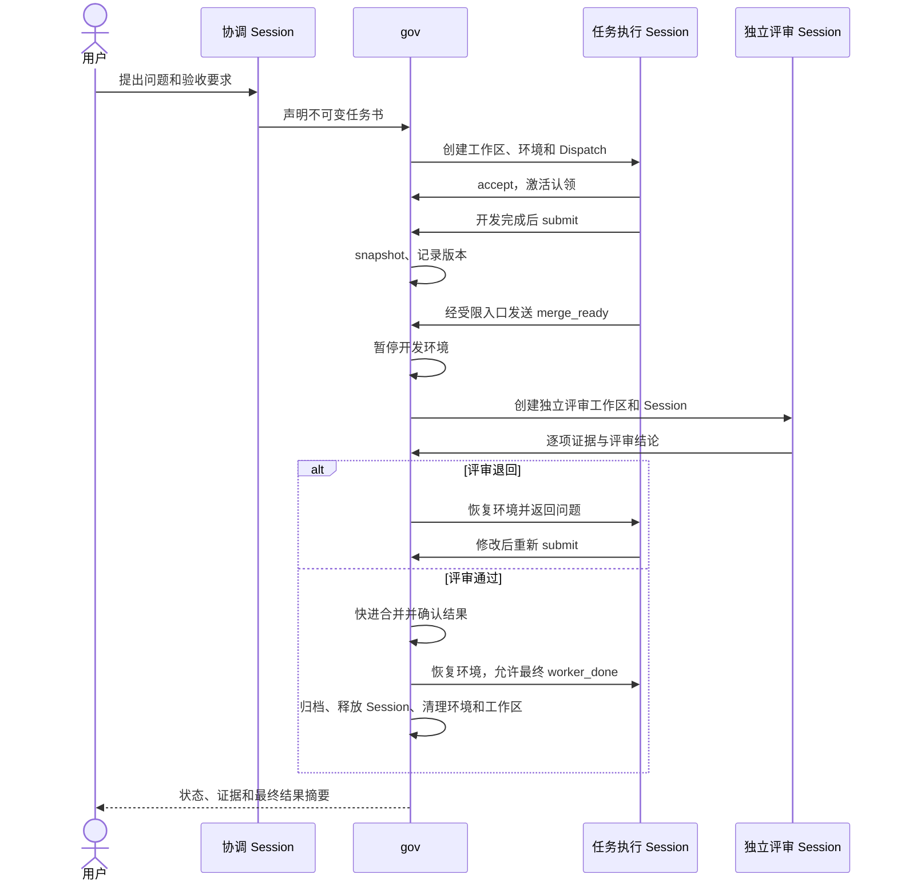

# Orca 多 Agent 治理系统评审说明

> 版本：v0.1  
> 日期：2026-11-06  
> 状态：设计评审材料，系统尚未实施  
> 技术设计：[governance-design.md](./governance-design.md)  
> 实施计划：[governance-tasks.md](./governance-tasks.md)

## 0. 评审结论

我们要构建的是一层**多 Agent 工作治理系统**，不是新的模型、聊天工具或 Agent 框架。系统把任务声明、执行认领、独立评审、版本合并和工作区清理连成一条可审计流程，使多个独立 Session 能在同一仓库中工作，同时限制每个 Session 的写入范围和版本权限。

源流程来自 DSH 中已经运行的三级 Agent 协作方式。现有 Orca 已具备独立 Session、Task/Dispatch、定向消息和环境生命周期，可以保留。需要新增的是宿主侧治理代理 `gov`、jj 工作区适配、独立评审与验收记录，以及限制 worker 权限的运行环境。

当前已经完成技术设计、实施计划和两轮文档复核，没有发现剩余文档阻塞项。**这表示文档内部一致，不表示系统已经可用。** 三项平台探针尚未执行，生产代码、真实 Agent 试点和受控运行均未开始。

## 1. 我们要解决什么问题

多个 Agent 同时开发时，问题通常不只是代码冲突，还包括以下工作状态失去约束：

1. **任务归属不清**：一个 Session 认领任务后，其他 Session 仍可能进入同一工作区修改。
2. **执行与签核不分**：开发 Session 自己报告完成，缺少独立上下文中的复验。
3. **任务范围漂移**：处理过程中发现的新问题不断加入原任务，原始目标逐渐丢失。
4. **兔子洞无法返回**：子问题处理完后，父任务没有明确恢复点和最新版本。
5. **完成状态含义混乱**：开发完成、评审通过、版本合并和环境清理被当成同一个状态。
6. **版本权限过大**：worker 能直接运行 git、jj 或 Orca 管理命令，提示词无法覆盖所有间接调用。
7. **协调上下文膨胀**：一个大 Session 同时跟踪多个任务、消息和转写记录，逐渐失去推进能力。
8. **清理依赖手工操作**：任务结束后仍残留终端、工作区、容器和构建产物。

目标系统把这些问题分别交给任务记录、独立身份、版本检查、运行环境和状态机处理，不要求模型自行记住所有规则。

## 2. 原有流程是什么

### 2.1 DSH 中的源流程

源流程已经形成了以下工作方式：

1. 协调 Session 声明任务，任务书写明问题、内含、外延、非目标和验收标准。
2. 独立任务执行 Session 认领工作。这里的「独立」指它不是协调 Session 的 subagent。
3. 认领时创建 jj workspace，并准备独立的 Nix 开发环境。
4. 任务执行 Session 组织开发 subagent 完成实际修改。
5. 调度方使用新上下文评审工作，逐项收集验收证据。
6. 不合格则退回原执行 Session，合格后才允许合并和清理。
7. 处理兔子洞时建立父子任务，子任务完成后提醒执行者返回父任务。
8. 一级协调者管理并行预算，二级执行者推进单个任务，三级执行者实际开发。
9. Session 之间以定向消息为主，避免群聊广播和无关消息。
10. 用户主要查看任务状态、问题和结果，不需要持续阅读模型输出。

源流程包含两条需要统一解释的规则：一处要求「声明方和 Claim 方不能签核」，另一处把签核协调交给任务执行 Session。目标设计采用前者，最终签核只能由新的独立评审 Session 完成。

### 2.2 现有 Orca runbook 流程

本机现有 runbook 面向 Orca 1.4.190，实际流程是：

1. 主会话讨论需求，形成 spec 和 GitLab tickets。
2. Orca 协调 Session 创建 Run，并启动两个设计评审 worker。
3. 协调 Session 汇总评审意见，分派修复和开发任务。
4. OpenCode 在 Git worktree 中开发。
5. Claude 或 Codex 复审实现；修复后的复审通常复用原评审终端。
6. 协调 Session 收集测试结果，开发 worker 或操作员 push 分支并创建 MR。
7. 操作员释放 worker、删除 worktree，并更新 ticket 状态。

该流程已经有实际运行记录，但它与目标治理流程不是同一套状态模型。本次核查时，本机 Orca 版本为 1.4.238，旧 runbook 中的部分命令和降级处理不能直接沿用。

### 2.3 保留与调整的部分

| 事项 | 现有 Orca runbook | 目标治理系统 |
|---|---|---|
| 协调入口 | Orca 协调 Session 驱动各阶段 | 保留 Orca，日常状态迁移由 `gov` 检查 |
| 任务事实 | GitLab ticket 与 Orca Task 分别承担不同记录 | `gov` 是治理状态唯一判定者，首版不同步 GitLab 状态 |
| 执行 Session | Orca worker | 保留，并增加执行者 `accept` 后才算认领生效 |
| 开发环境 | 本机 Git worktree | jj workspace 加本地 Docker SSH-mode |
| 开发完成 | `worker_done` 结算 Task | 先发 `merge_ready`，合并后才允许正常 `worker_done` |
| 评审上下文 | 修复后的复审可复用原评审终端 | 每次提交都创建新的独立评审 Session 和工作区 |
| 验收记录 | 报告、测试结果和评审意见 | 每条验收标准都有版本绑定的结构化证据 |
| 依赖推进 | 部分场景手工 `task-update --status ready` | `gov` 判断依赖，正常流程不调用 `task-update` |
| 版本操作 | worker 可直接使用 Git | worker 不直接使用 git/jj，`gov` 独占合并 |
| 合并目标 | push 分支并创建 MR | 首版只做本地快进合并，不自动 push 或创建 MR |
| 清理 | 按清单手工释放和删除 | 合并确认、写入者退出和归档后自动清理 |

## 3. 我们要构建什么

### 3.1 系统组成

| 组件 | 承担的职责 | 不承担的职责 |
|---|---|---|
| Orca | 创建和监督独立 Session，传递消息，管理 Dispatch 和环境 | 不单独判定治理签核 |
| `gov` | 保存任务、认领、评审、证据、合并和恢复状态，检查角色权限 | 不代替模型开发，不生成评审结论 |
| SQLite | 保存治理状态、操作记录和证据索引 | 不保存明文令牌 |
| jj | 提供任务工作区、版本快照、rebase、快进和工作区注销 | 不提供工作区级写入权限 |
| Docker SSH-mode | 隔离 worker 的文件、进程、资源和控制通道 | 不承担任务调度 |
| 受限启动器 | 以同一入口代理角色允许的 `gov` 与 Orca 动作 | 不接受任意 shell、管理命令或身份参数 |
| Skills、hooks、提示词 | 教会各类 Session 使用正确接口，注入任务上下文 | 不作为认领、签核或文件权限的安全边界 |

`gov` 运行在宿主侧。任务执行 Session 和评审 Session 运行在各自的临时环境中，只能访问当前工作区和受限接口。真实 Orca CLI 由独立系统用户 `orca-broker` 持有，Agent 不能直接读取其凭据或执行其二进制。

### 3.2 三级角色与独立评审

1. **一级协调 Session**：声明顶层任务、控制并行预算、处理异常，不写业务代码，不签核。
2. **二级任务执行 Session**：接受认领、组织开发、声明子任务、提交验收，不签核。
3. **三级开发执行者**：实际修改文件和运行测试，首版按既定分工使用 OpenCode。
4. **独立评审 Session**：在新的上下文中复验并签核，首版使用 Claude 或 Codex。

评审 Session 不属于上述三级开发上下文的延续。任务声明者和任何历史认领者都不能成为该任务评审者，即使原 Session 换了一个新的 Dispatch。

### 3.3 首个版本明确不做

1. 不自动 push、创建 MR、部署或修改 GitLab Issue。
2. 不接入云端 VM、远程服务器或多宿主调度。
3. 不支持一个父任务同时等待多个子任务。
4. 不自动解决冲突，也不允许非快进合并。
5. 不自动切换模型或供应商。
6. 不开发新的 Web 面板。
7. 不在核心版本中引入 Nix；它在后续阶段单独接入和验收。
8. 不让视觉、设备或跨系统任务只凭测试与日志自动签核。

## 4. 目标任务流程

目标流程把「开发完成」「评审通过」「版本合并」「资源清理」分成不同事实：

### 4.1 各状态的含义

| 状态或消息 | 表示什么 | 不能表示什么 |
|---|---|---|
| `DECLARED` | 任务书已创建并固定 | 任务已被认领 |
| `ACTIVE` | 执行 Session 已接受认领，可以开发 | 工作已经通过验收 |
| `merge_ready` | 开发方申请评审，版本已固定 | 任务已通过或已合并 |
| `IN_REVIEW` | 独立评审正在复验 | 开发方可以继续在原工作区修改 |
| `CHANGES_REQUESTED` | 评审退回，需要原执行者继续 | 任务失败或需要换认领者 |
| `APPROVED` | 指定版本满足验收标准 | 目标分支已经完成合并 |
| `MERGED` | 快进合并已读取并确认 | 环境和 Session 已清理 |
| `COMPLETED` | 合并、退出、归档和清理都已完成 | 后续不再需要保留审计记录 |

## 5. 典型使用路线

以下示例用于说明使用方式，不是已经执行过的任务。假设用户要求：「在某个 Agent 包内修复一个纯函数的边界条件，并补上回归测试」。

### 5.1 用户先确认任务书

协调 Session 把自然语言需求整理为：

| 任务书字段 | 示例内容 |
|---|---|
| 问题 | 指定输入触发错误结果，现有测试没有覆盖 |
| 内含 | 修复该函数并增加回归测试 |
| 外延 | 该 Agent 包内的指定实现文件和测试文件 |
| 非目标 | 不调整公共接口、不改依赖、不重构其他模块 |
| 允许路径 | 明确列出两个仓库相对路径 |
| 目标 | 创建任务时指定的 bookmark 和 base commit |
| 验收标准 | 新测试覆盖边界条件；相关测试套件通过；评审者在独立工作区复验 |

任务书创建后不能原地修改。用户如果扩大范围，需要创建新任务版本，而不是让 worker 在执行中自行扩大。

### 5.2 系统创建并确认认领

`gov` 固定 base commit，创建 jj workspace 和任务环境，再通过 Orca 启动独立执行 Session。只有该 Session 调用 `accept` 后，任务才进入活动状态。

如果创建环境或 Session 的结果不确定，`gov` 会保留当前操作记录，不会同时启动第二个写入者。

### 5.3 执行 Session 组织开发

执行 Session 阅读任务书，组织 OpenCode 修改允许路径并运行测试。它可以直接要求开发执行者补充证据，但不能修改验收标准、合并版本或自行签核。

用户不需要持续查看模型输出。日常界面只需要展示当前阶段、阻塞原因和下一步。

### 5.4 提交后暂停开发环境

开发完成后，执行 Session 调用 `task submit`。`gov` 记录 commit ID、tree ID 和开发证据，确认受限启动器已在原终端发送 `merge_ready`，然后暂停原环境。

暂停期间没有开发写入者，评审看到的是固定版本。连接中断时使用原请求 ID 查询结果，不创建第二次提交。

### 5.5 独立评审复验

新的 Claude 或 Codex 评审 Session 在独立工作区中：

1. 对照任务书检查范围和实际 diff。
2. 重新运行可自动执行的验收项目。
3. 检查每条证据是否属于被审版本。
4. 记录问题严重度和处理状态。
5. 给出通过或退回结论。

评审者不能修改被审版本。评审工作区中受版本控制的 tree 如果发生变化，本次评审无效。

### 5.6 合并、通知与清理

评审通过后，`gov` 再次检查目标没有移动，然后执行快进合并。确认合并结果后，恢复原执行 Session，使其发送最终 `worker_done`，再释放 Session、归档证据、删除环境并注销 jj workspace。

用户最终看到的是：修改摘要、验收证据、合并结果、评审者、遗留问题和清理结果，而不是所有中间对话。

## 6. 典型异常路线

### 6.1 评审退回

1. 评审者指出未满足的验收标准，并附上对应证据。
2. `gov` 先检查暂停中的工作副本仍等于提交版本。
3. 恢复原执行环境，将问题定向发送给原认领 Dispatch。
4. 原执行 Session 修复后重新提交。
5. 系统创建新的评审 Session，旧评审不能自动充当新签核。
6. 达到评审轮数上限后转人工处理，不无限修复。

原执行者负责修复，不代表原执行者可以签核。

### 6.2 开发中进入兔子洞

1. 执行 Session 发现一个必须先解决的子问题，提交完整子任务书。
2. 子任务必须与父任务同仓库，允许路径不能超过父任务范围。
3. `gov` 固定父版本并暂停父环境，然后才创建子任务。
4. 子任务走独立的认领、开发、评审和签核流程。
5. 子任务只合入父任务版本，不直接合入顶层目标分支。
6. `gov` 检查父工作区没有额外改动后恢复父环境。
7. 原 `task split` 请求返回子任务摘要、新的 `parent_revision` 和「返回父任务继续处理」的指令。
8. 父执行 Session 继续原目标，父任务最终仍需独立评审。

重复恢复消息不能产生重复修改。父任务有活动子任务时，不能直接替换父认领。

### 6.3 目标分支移动或出现冲突

1. 如果目标 bookmark 已移动，`gov` 不允许沿用旧验收结果直接合并。
2. 执行 Session 请求 `task rebase`，由 `gov` 在宿主侧执行。
3. 没有冲突时，执行者重新运行检查并提交，随后重新评审。
4. 有冲突时，执行者只编辑冲突文件，不直接运行 jj。
5. 下一次 `task submit` 由 `gov` snapshot 并确认冲突已经解决。
6. 新 commit 和 tree 必须重新取得验收证据。

已签核后、合并前目标发生移动时，旧签核同样失效。合并结果不确定时不自动重试，也不删除工作区。

### 6.4 Session 中断或需要替换

协调 Session 替换时，新 Session 通过 Orca `run-use` 和 `gov status` 恢复，不依赖旧协调上下文。

任务执行 Session 替换时：

1. 先查明旧 writer 已退出或被停止。
2. 将旧认领标记为 `FENCED`，撤销其令牌。
3. 新 Dispatch 接受认领后才能继续写入。
4. 旧提交和评审不能直接转移给新认领，必须重新提交。

如果任何外部结果不确定，系统保持阻塞并展示人工恢复入口，不通过重复启动来掩盖不确定状态。

### 6.5 需要人工验收

视觉、设备、实时行为或跨系统结果不能只凭单元测试和日志签核。任务书需要把这类标准标为 `manual`，由人工操作员提供验收记录。人工记录未解决前，自动签核不能通过。

### 6.6 清理失败

合并已经确认，但环境删除、归档或 jj 注销失败时，任务进入 `cleanup_pending`。系统保留已合并事实和清理操作记录，不重新打开开发任务，也不自动回滚合并。

## 7. 用户与各类 Session 实际看到什么

| 角色 | 日常看到的内容 | 不需要看到的内容 |
|---|---|---|
| 用户 | 任务书、当前状态、待回答的问题、验收证据、合并和清理结果 | 每个模型的流式输出和全部工具调用 |
| 协调 Session | 待声明任务、并行预算、异常、人工决策请求 | 每个 worker 的完整转写记录 |
| 任务执行 Session | 当前任务书、工作区、开发工具、退回意见、父任务恢复结果 | 其他任务的工作区和通用 Orca 管理接口 |
| 开发执行者 | 允许修改的文件、测试命令和任务边界 | 任务状态修改、签核和合并接口 |
| 评审 Session | 任务书、被审版本、验收标准、证据和 diff | 开发 Session 的私有上下文和可写工作区 |
| 人工操作员 | 操作回执、不确定状态、残余资源和恢复动作 | 明文令牌和不必要的凭据 |

协调 Session 可以通过 Orca 搜索相关 Session 片段，但完整转写记录只在排障时读取。任务执行和评审 Session 不具备跨 Session 搜索权限。

## 8. 权限与版本规则如何体现到日常使用

1. worker 不直接运行 git/jj；快照、rebase、合并和工作区注销都由 `gov` 执行。
2. worker 不直接调用通用 Orca CLI；`gov` 和 Orca 动作共用同一个受限启动器。
3. 启动器从系统用户、容器实例和 `gov` 记录反查身份，Agent 不能用伪造的 Task 或 Dispatch 参数替换身份。
4. 真实 Orca CLI 在原 worker 终端中运行，保留 Orca 对该 Dispatch 的身份判定。
5. 每个环境只能访问当前任务目录，不能访问其他任务目录、宿主凭据或 Docker socket。
6. 验收绑定 commit ID 和 tree ID；代码变化后需要重新验收。
7. 只有目标未移动时才允许快进合并，保证合入结果与已验收结果一致。
8. 环境暂停用于评审和父子任务等待，不能仅靠提示词要求 worker 不修改。

这些规则需要通过平台探针和隔离测试验证，不能只凭配置名称推断已经成立。

## 9. 当前状态与实施路线

### 9.1 已完成

1. DSH 源流程与现有 Orca 能力核查。
2. jj、Nix、Claude hooks/permissions/sandbox 的官方文档核查。
3. 技术设计 v0.2。
4. 实施计划 v0.2，共 23 个任务和 G0–G12 验收标准。
5. 设计文档独立复核：首轮 12 项问题、复审 4 项问题均已处理，最终复核没有剩余阻塞。

### 9.2 尚未完成

1. 没有实现 `gov`、受限启动器或环境 recipe。
2. 没有执行三项平台探针。
3. 没有运行真实 Agent 试点。
4. 没有证明纯 jj 目录能完整接入 Orca。
5. 没有证明启动器能保留原 worker 的 Dispatch 身份。
6. 没有证明容器内版本元数据权限满足要求。
7. 没有接入 Nix，也没有自动 push、部署或无人值守运行。

### 9.3 三项平台探针

| 探针 | 要验证的事实 | 失败时的处理 |
|---|---|---|
| 纯 jj 目录接入 Orca | 能注册、启动独立 Agent 并删除，且 jj 仓库状态保持完整 | 停止后续环境及生命周期实施 |
| 受限启动器与 Dispatch 身份 | worker 注入指令能进入启动器，真实 CLI 在原终端中被 Orca 识别为同一 worker | 停止受控运行实施，转入 Orca 能力修改 |
| 工作区元数据权限 | Agent 能写源码，但不能修改、重命名或删除 `.jj` / `.git` | 停止受控运行实施，不把宿主测试当作隔离证据 |

### 9.4 实施顺序

1. **Phase 0**：文档隔离和三项平台探针。
2. **Phase 1–3**：任务记录、身份、Orca/jj/环境适配，以及单任务完整生命周期。
3. **Phase 4**：故障恢复和父子任务。
4. **Phase 5**：受限启动器、容器隔离、角色提示词和 hooks。
5. **Phase 6**：全量一致性测试、预算、真实 Agent 试点和 runbook 更新。
6. **Phase 7**：Nix 环境及双任务清理验证。

## 10. 建议的评审决定

建议只批准 **Phase 0 和后续确定性治理核心的实施准备**，暂不批准生产受控运行或无人值守使用。三项探针通过后，再评审核心实现；真实 Agent 试点通过后，再决定是否扩大并行任务数。

本次评审需要确认的边界包括：

1. `gov` 是治理状态唯一判定者，Orca 继续管理 Session 和 Dispatch。
2. 最终签核必须由新的独立评审 Session 完成。
3. 首版只允许快进合并，rebase 后必须重新验收。
4. 首版使用本地 Docker SSH-mode，不把宿主直接运行当作受控替代。
5. 首版不自动 push、不接入云资源、不开发 Web 面板，Nix 延后。
6. 视觉、设备和跨系统结果仍需要人工验收。

## 11. 术语表

| 术语 | 含义 |
|---|---|
| DSH | 产生源流程的 Agent Harness；本文只引用其工作方式，不讨论其内部实现 |
| `gov` | 规划中的宿主治理代理，负责任务状态、权限检查、证据、合并和恢复 |
| Task | 一项需要完成的工作 |
| Dispatch | Orca 对某个 Task 的一次权威执行尝试；本设计也用它标识认领代次 |
| `merge_ready` | 开发方申请评审的消息，不结算原 Task |
| `worker_done` | Orca 的 worker 完成消息；开发任务只能在合并确认后正常发送 |
| jj workspace | jj 管理的独立工作副本，多个 workspace 共享一个仓库 |
| tree ID | 某个版本实际文件树的标识，用于防止只凭 change ID 复用旧验收 |
| 受限启动器 | 任务环境内唯一的 `gov` 与 Orca 动作入口，按角色和 Dispatch 检查权限 |
| SSH-mode | Orca 通过 SSH 管理任务环境，环境内不运行 Orca server |
| `FENCED` | 旧认领已失效，不能继续提交或写入的状态 |
| `cleanup_pending` | 合并已确认，但归档、环境删除或工作区注销尚未全部完成 |

## 12. 相关文档

- [技术设计](./governance-design.md)：状态机、数据记录、权限、版本和恢复的详细定义。
- [实施计划](./governance-tasks.md)：23 个实施任务、依赖、文件所有权和验收标准。
- [现有 Orca runbook](./runbook.md)：迁移前的 GitLab、Orca 和 worker 工作流程。
