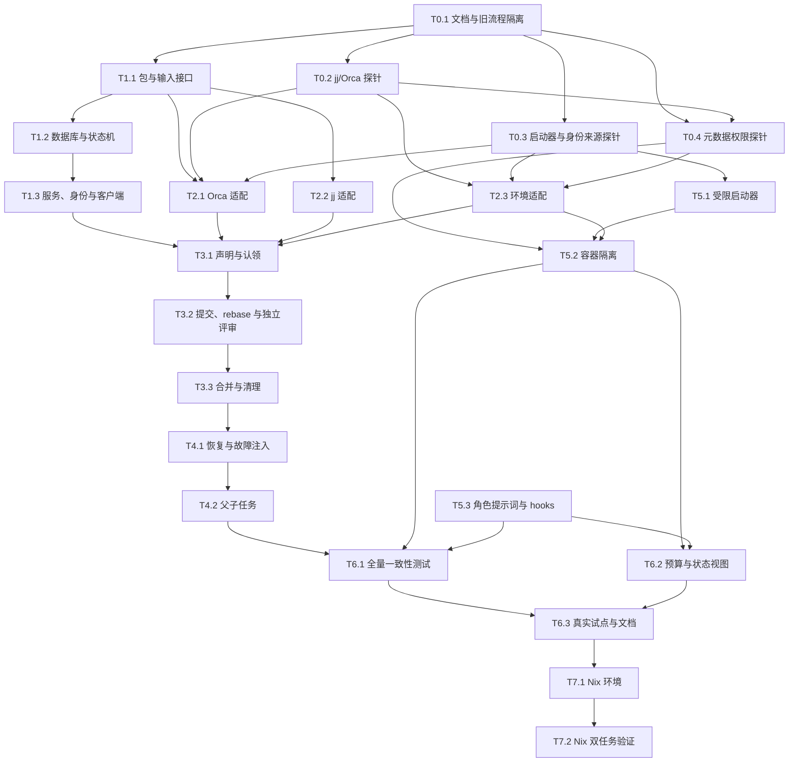

# Orca 多 Agent 治理代理实施计划

> 版本：v0.2（评审修订，待平台探针）  
> 日期：2026-11-04  
> 技术设计：[governance-design.md](./governance-design.md)  
> 实施目录：`/Users/souler/Documents/daqian/playground/orca-dev-workflow`  
> 规则：任务只描述文件边界、输入、输出、接受规则和验证，不预写实现代码

## 1. 目标与交付边界

交付一个可在本机运行的 `gov` 包，使 Orca 独立 Session 能按「声明、指派认领、执行者接受、开发提交、独立评审、快进合并、自动清理」完成一个 jj 任务。受控版本在本地 Docker SSH-mode 中运行 worker，并通过受限启动器保留 Orca Dispatch 身份来源。

首个版本只支持一个仓库配置、一个活动子任务、目标快进合并和自动验收任务。自动推送、云端环境、多父任务并行、Web 面板、模型自动路由和 Nix 均不属于核心版本。

### 1.1 实施红线

1. 不在 `agents-impl` 产品仓内实现治理工具。
2. 不使用 Orca `task-update` 推进正常业务流程。
3. 不让 worker 直接执行通用 Orca CLI、git 或 jj。
4. 不把宿主直接运行模式称为受控运行。
5. 不在结果不确定时自动重试 worker 启动、合并或环境删除。
6. 不在任务清理时执行全局 Nix 垃圾回收。
7. 不自动 push、创建 MR、部署或提交本计划之外的代码。
8. 开发与修复 worker 使用 OpenCode，评审使用 Claude 或 Codex；改变该分工需要先取得用户同意。

## 2. 实施结构

### Track A：确定性治理核心

完成任务书、SQLite、身份、状态机、Orca/jj 适配、评审、合并、清理和恢复。Track A 使用临时仓库与测试环境验证完整生命周期，包括清理；它不用于受控生产运行。Track A 测试可通过 Orca 适配层模拟 worker 消息，只验证治理状态，不把这些消息当作受限启动器或身份隔离证据。

### Track B：受控运行与发布

完成受限启动器、系统用户隔离、Docker SSH-mode、资源限制、角色提示词、并发预算、真实 Agent 试点和 runbook 更新。Track B 不改变 Track A 的业务状态归属。

### Phase 0 阻塞条件

探针的阻塞范围分别如下：

1. T0.2 的纯 jj 目录注册、启动或删除失败时，T2.3 及其后所有生命周期任务停止，Track A 与 Track B 都不得继续到这些任务。
2. T0.3 的受限启动器或 Dispatch 身份来源验证失败时，Track B 停止；Track A 只能用模拟消息继续治理状态测试。
3. T0.4 的元数据权限验证失败时，Track B 停止；Track A 不得把宿主权限结果当作容器隔离证据。

任何探针失败都要记录平台缺口。Track A 的测试不得被写成受控运行证据。

## 3. 统一命令与产物

实施后只使用以下命令，不在任务中猜测其他入口：

| 命令 | 用途 |
|---|---|
| `pnpm test` | 运行全部确定性测试，不在首个失败处停止 |
| `pnpm typecheck` | TypeScript 严格类型检查 |
| `pnpm check` | 类型、单元、集成和生成物检查 |
| `pnpm gov doctor -- --json` | 检查 Node、Orca、jj、Docker、目录和版本 |
| `pnpm gov serve` | 启动宿主治理服务 |
| `pnpm test:integration` | 临时 jj 仓库与真实 Orca CLI 集成测试 |
| `pnpm test:isolation` | 一次性 Docker 环境隔离测试 |
| `pnpm test:conformance` | 全部治理场景和故障注入 |

状态数据、证据和临时工作区必须位于测试专用目录。测试不得使用真实业务仓库、真实分支或个人凭据。

## 4. 依赖图与执行波次

| Wave | 可并行任务 | 最大并行数 | 退出条件 |
|---|---|---:|---|
| W0 | T0.1 | 1 | 旧 runbook 与新治理边界已区分 |
| W1 | T0.2、T0.3、T1.1 | 3 | 两项探针有结论；包接口已固定 |
| W1b | T0.4 | 1 | 元数据权限探针完成（依赖 T0.2 的 jj workspace） |
| W2 | T1.2、T2.1、T2.2 | 3 | 状态机和两个只读/版本适配层通过测试 |
| W3 | T1.3、T2.3 | 2 | 服务身份、客户端和环境生命周期可用 |
| W4 | T3.1 | 1 | 并发认领与接受流程通过 |
| W5 | T3.2 | 1 | 提交、rebase、独立评审与逐项证据通过 |
| W6 | T3.3 | 1 | 合并、归档和清理完整 |
| W7a | T4.1 | 1 | 操作恢复与故障注入通过 |
| W7b | T4.2 | 1 | 父子任务与父环境暂停/恢复通过 |
| W8 | T5.1 | 1 | 启动器权限与身份来源通过 |
| W9 | T5.2、T5.3 | 2 | 容器隔离和角色材料通过 |
| W10 | T6.1、T6.2 | 2 | 全量一致性测试、预算和状态视图通过 |
| W11 | T6.3 | 1 | 真实试点完成，runbook 已更新 |
| W12 | T7.1 | 1 | Nix 环境可用 |
| W13 | T7.2 | 1 | Nix 双任务与清理验证通过 |

W1 的三路并行只在临时资源充足时执行；探针共享 Orca 或 Docker 资源时按 T0.2、T0.3 顺序执行。T0.4 依赖 T0.2 产出的 jj workspace，必须排在 T0.2 之后。

## 5. 文件所有权

| 任务 | 唯一写入范围 |
|---|---|
| T0.1 | `runbook.md` 顶部提示、`probes/README.md` |
| T0.2–T0.4 | `probes/` 下各自报告；临时目录各自独立 |
| T1.1 | `package.json`、`pnpm-lock.yaml`、`tsconfig.json`、`src/config.ts`、`src/domain/`、`test/unit/domain/` |
| T1.2 | `src/db/`、`src/state/`、`test/unit/state/` |
| T1.3 | `src/server.ts`、`src/cli.ts`、`src/auth.ts`、`src/api.ts`、`src/operations.ts`、`test/unit/api/` |
| T2.1 | `src/adapters/orca.ts`、`test/integration/orca/` |
| T2.2 | `src/adapters/jj.ts`、`test/integration/jj/` |
| T2.3 | `src/adapters/environment.ts`、`orca.yaml`、`scripts/orca-vm/`、`test/integration/environment/` |
| T3.1 | `src/services/tasks.ts`、`src/services/claims.ts`、`src/services/workspaces.ts`、`test/unit/claims/` |
| T3.2 | `src/services/submissions.ts`、`src/services/rebases.ts`、`src/services/reviews.ts`、`src/services/evidence.ts`、`test/unit/reviews/` |
| T3.3 | `src/services/merges.ts`、`src/services/cleanup.ts`、`test/integration/lifecycle/` |
| T4.1 | `src/services/recovery.ts`、`test/integration/recovery/` |
| T4.2 | `src/services/children.ts`、`test/integration/children/` |
| T5.1 | `src/guard/`、`deploy/sudoers/`、`test/isolation/guard/` |
| T5.2 | `deploy/docker/`、`deploy/README.md`、`test/isolation/environment/` |
| T5.3 | `prompts/`、`hooks/`、`test/unit/prompts/` |
| T6.1 | `test/conformance/` |
| T6.2 | `src/services/budgets.ts`、`src/services/status.ts`、`test/unit/budgets/` |
| T6.3 | `runbook.md`、`docs/pilot/`、`/Users/souler/yfp/.claude/skills/orca-coord/SKILL.md` |
| T7.1 | `deploy/nix/` |
| T7.2 | `test/isolation/nix/` |

同一 Wave 中不得让其他任务写入已分配文件。跨文件接口先在对应任务输入中引用已完成的领域类型，不在并行任务中同时修改接口生产者和消费者。

## 6. Phase 0：文档隔离与平台探针

### T0.1 标记旧流程并固定探针协议

- **Files**：修改 `runbook.md` 顶部；创建 `probes/README.md`。
- **Inputs**：`governance-design.md` §1、§3、§15；现有 runbook 的 Phase 2–4。
- **Outputs**：旧流程适用范围说明；三项探针的版本、临时资源、证据、真实模型确认要求和停止条件。
- **Accept rule**：旧 runbook 的手工 `task-update`、复用评审终端和开发 worker push 不再被描述为新治理流程步骤。
- **Verification gate**：两份文档链接有效；探针不指向真实业务仓库；所有外部资源都有清理责任人；凡需真实模型的探针在执行前单独取得用户确认。

### T0.2 验证纯 jj 目录的 Orca 生命周期

- **Files**：只创建 `probes/orca-jj-folder.md`；临时 jj 仓库位于独立临时目录。
- **Inputs**：Orca `repo add`、`repo show`、`agent launch`、`worktree list`、`worktree rm` 的当前帮助；jj 0.41.0。
- **Outputs**：folder kind 判定、启动回执、worktree ID、实际路径、删除行为、残余资源清单。
- **Accept rule**：纯 jj 目录可注册、可启动独立 Agent、可删除，且 jj 共享仓库仍可查询；失败则记录准确错误，不尝试 Git worktree 替代。
- **Verification gate**：报告包含命令版本、JSON 关键字段、退出码和清理后 `worktree list` / `jj workspace list` 结果。

### T0.3 验证受限启动器与 Dispatch 身份来源

- **Files**：只创建 `probes/orca-guard-provenance.md` 和临时探针资源。
- **Inputs**：Orca `worker-start`、worker contract、placement/remote、SSH-mode 文档；双系统用户临时容器。
- **Outputs**：实际 worker 注入指令的 executable 形态、PATH/绝对路径行为、启动器调用结果、Orca 接受的 Dispatch 身份、宿主直接代发的对照结果。
- **Accept rule**：Agent 只能进入固定启动器；启动器从系统用户、容器实例和预置的最小身份记录（未来由 `gov` 提供）取得身份，不使用 Agent 提供的注入指令字段授权；`check` 和允许的消息在原 worker 身份下被接受；管理命令不能执行。
- **Verification gate**：至少一次 `merge_ready` 或等价非终态消息具有正确 Dispatch 回执；提前 `worker_done` 被拒绝；伪造注入指令中的 Task/Dispatch 不能改变身份；不能证明身份来源时 Track B 停止。

### T0.4 验证工作文件可写且版本元数据不可写

- **Files**：只创建 `probes/workspace-metadata-acl.md` 和临时容器配置。
- **Inputs**：T0.2 的 jj workspace；Docker 非 root 用户、文件所有者、目录权限和符号链接测试。
- **Outputs**：正常源码写入结果，`.jj` / `.git` 的读取、修改、重命名、删除结果，宿主 snapshot 结果。
- **Accept rule**：普通文件新增和修改成功；所有元数据变更路径失败；符号链接不能绕过；宿主能读取预期源码 diff。
- **Verification gate**：直接文件操作和 Python/Node 子进程操作都覆盖；任何元数据写成功都阻塞 Track B。

## 7. Phase 1：包、接口与持久状态

### T1.1 建立 Node.js 包和领域输入

- **Files**：创建 `package.json`、锁文件、TypeScript 配置、`src/config.ts`、`src/domain/` 及 `test/unit/domain/`。
- **Inputs**：设计 §5.2、§6.1；本机 Node.js 24.15.0 与 pnpm 10.33.2 探针。
- **Outputs**：严格 TypeScript 包、Zod 任务书、配置、验收标准、角色和错误码定义。
- **Accept rule**：未知字段、任意宿主路径、空 `owned_paths`、空验收标准、非配置仓库和非法目标均被拒绝。
- **Verification gate**：`pnpm typecheck` 与领域单元测试通过；Node 版本检查在不符合 24 LTS 时明确失败。

### T1.2 实现 SQLite 迁移与状态机

- **Files**：创建 `src/db/`、`src/state/`、`test/unit/state/`。
- **Inputs**：设计 §6.2、§7；T1.1 领域类型。
- **Outputs**：版本化迁移、设计 §6.2 全部记录的存储、合法状态迁移检查。
- **Accept rule**：同一任务最多一个非终态认领；提交、评审和合并具有业务唯一约束；非法迁移不能写入。
- **Verification gate**：并发事务、回滚、重启后迁移、外键和全部状态迁移测试通过。

### T1.3 实现宿主服务、角色令牌与客户端

- **Files**：创建 `src/server.ts`、`src/cli.ts`、`src/auth.ts`、`src/api.ts`、`src/operations.ts`、`test/unit/api/`。
- **Inputs**：设计 §4、§9、§13；T1.2 存储。
- **Outputs**：宿主专用 JSON API、命令行客户端、角色令牌、请求 ID、操作记录、请求大小和超时限制，以及 Node/配置/数据库的基础 `doctor` 检查。
- **Accept rule**：客户端不能自行指定身份；令牌限定角色和任务；服务不执行请求中的 shell 文本；非授权动作返回稳定错误码；同一请求 ID 不同请求哈希必须拒绝；数据库事务中不调用外部进程。
- **Verification gate**：伪造 Session、跨任务令牌、过期令牌、重复请求、请求哈希冲突、超大请求、基础 doctor 和服务重启测试通过。

## 8. Phase 2：外部系统适配

### T2.1 实现 Orca CLI 适配层

- **Files**：创建 `src/adapters/orca.ts` 和 `test/integration/orca/`。
- **Inputs**：T0.2/T0.3 证据；当前 Orca JSON 输出；T1.1 领域类型。
- **Outputs**：版本与能力检查、Task/Session/Dispatch 创建和查询、定向消息、受限搜索结果与分页读取、`run-use` 协调恢复、`worker-read` 有界读取、release、worktree 删除、统一回执和 Orca `doctor` 检查。
- **Accept rule**：同一 Run 使用同一 Orca executable；所有 JSON 经结构校验；失败保留 `failedStage`、`residualResources` 和安全错误码；正常路径不调用 `task-update`；Session 读取默认有数量和范围上限。
- **Verification gate**：真实 Orca 临时 Run 覆盖启动、重复启动拒绝、终端不匹配、定向消息、搜索/分页读取、新协调 Session `run-use` 恢复、`worker-read` 边界、结果不确定、doctor 和清理。

### T2.2 实现 jj 适配层

- **Files**：创建 `src/adapters/jj.ts` 和 `test/integration/jj/`。
- **Inputs**：jj 0.41.0 官方 workspace、bookmark、conflict 文档；T1.1 任务类型。
- **Outputs**：base 解析、workspace 创建/注销、snapshot、commit/tree 读取、含重命名的路径 diff、rebase、冲突查询、快进、op log 回执和 jj `doctor` 检查。
- **Accept rule**：不接受任意仓库路径；bookmark 不能替代 base；目标移动或非快进时不合并；冲突不自动解决；rebase 后必须能识别未解决冲突和新 tree。
- **Verification gate**：多 workspace、目标移动、rebase 新 tree、冲突及 snapshot 后解决、重命名/符号链接越界、workspace stale、forget、doctor 和异常退出测试通过。

### T2.3 实现本地 Docker SSH-mode 环境适配

- **Files**：创建 `src/adapters/environment.ts`、`orca.yaml`、`scripts/orca-vm/`、`test/integration/environment/`。
- **Inputs**：T0.2–T0.4；Orca per-workspace environment recipe 接口。
- **Outputs**：create、suspend、resume、destroy、静态与综合 `doctor`、资源 ID 和残余资源回执。
- **Accept rule**：不启动云资源；create 输出符合 SSH-mode；suspend 后任务进程不能写入，resume 保留原终端和 Session；destroy 具有幂等记录；失败保留环境 ID；不提供 `destroy: none`。
- **Verification gate**：免费静态检查无警告；临时容器 create/suspend/resume/destroy 两次结果一致；综合 `doctor` 同时报告 Node、Orca、jj、Docker、目录和版本；异常退出后资源可查明。

## 9. Phase 3：单任务完整生命周期

### T3.1 实现声明、指派认领和接受

- **Files**：创建 `src/services/tasks.ts`、`claims.ts`、`workspaces.ts` 和 `test/unit/claims/`。
- **Inputs**：T1.1–T2.3 的输出；设计 §8.1。
- **Outputs**：任务声明、认领保留、环境准备、Dispatch 绑定、执行者接受和完整回执。
- **Accept rule**：只有执行者 `accept` 后才允许开发；准备中或结果不确定也阻止第二认领；任何历史认领均可查询。
- **Verification gate**：两个并发请求只产生一个有效执行环境；接受前后身份一致；各准备阶段中断不会留下第二个写入者。

### T3.2 实现提交、rebase、独立评审和证据

- **Files**：创建 `src/services/submissions.ts`、`src/services/rebases.ts`、`src/services/reviews.ts`、`src/services/evidence.ts` 和 `test/unit/reviews/`。
- **Inputs**：设计 §6.2、§6.3、§8.2、§8.3、§10；T3.1 活动认领；T1.1 任务级预算；T1.2 事件记录。
- **Outputs**：版本固定、开发环境暂停/恢复、rebase 请求与冲突处理、旧证据失效、开发证据、独立评审 Session/工作区、问题记录、逐项评审证据、通过或退回结果。
- **Accept rule**：声明者和任何历史认领者不能评审；每次提交使用新 Session；版本、tree、证据、范围或任务预算任一不符都不能通过；`OPEN` 中高严重度问题阻止签核，低严重度问题必须具有处理状态和理由；rebase 后必须重新提交，snapshot 后仍有冲突时拒绝。
- **Verification gate**：覆盖声明者/当前认领者/历史认领者换 Dispatch 后的身份拒绝、缺证据、人工证据、版本漂移、评审 tree 改动、重复提交、问题分级、任务预算、评审退回、退回恢复前 `WORKSPACE_DIVERGED`、目标移动、无冲突 rebase、冲突解决后重新评审、环境暂停失败，以及暂停后使用原请求 ID 恢复结果。

### T3.3 实现快进合并、归档和清理

- **Files**：创建 `src/services/merges.ts`、`cleanup.ts` 和 `test/integration/lifecycle/`。
- **Inputs**：T3.2 通过结论；T2.1–T2.3 回执；设计 §8.4。
- **Outputs**：目标串行合并、合并确认、正常完成、归档、环境删除、jj 注销和清理状态。
- **Accept rule**：目标移动使旧签核失效；未确认合并不删除；无活动写入者和归档完成后才清理；清理失败不重开开发。
- **Verification gate**：正常完成、worker 消失、合并前目标移动、合并后恢复前 `WORKSPACE_DIVERGED`、归档失败、环境删除失败和重复清理均有证据；版本分叉时不得自动回滚已确认合并。

## 10. Phase 4：恢复与父子任务

### T4.1 完成操作恢复和故障注入

- **Files**：创建 `src/services/recovery.ts` 和 `test/integration/recovery/`。
- **Inputs**：T1.3 操作记录；T3.1–T3.3 的外部回执；设计 §7.3、§13。
- **Outputs**：操作检查点、结果核对、人工恢复入口、协调 Session 替换、执行认领替换、任务版本替代和各阶段故障注入报告。
- **Accept rule**：结果不确定时不自动重试；只有查明外部事实才能恢复；恢复不重复创建 Session、合并或删除；旧 writer 未明确退出前不能替换认领；旧提交和评审不能转移给新认领；范围变化以新任务版本替代。
- **Verification gate**：在每个 Orca、jj、Docker 调用前后各注入一次退出，覆盖协调 Session 恢复、执行 Session 替换、任务替代和旧 writer 仍存活，全部达到可解释状态且无重复副作用。

### T4.2 实现单阻塞子任务与父任务恢复

- **Files**：创建 `src/services/children.ts` 和 `test/integration/children/`。
- **Inputs**：设计 §8.5；T3.3 合并能力；T4.1 操作记录。
- **Outputs**：父版本锁定、父环境暂停/恢复、子任务声明/认领/评审、父版本快进、父工作区更新、幂等恢复消息。
- **Accept rule**：父任务等待时环境必须暂停；子任务路径必须属于父任务范围且不能替换父认领；子任务不直接合入顶层 bookmark；恢复前发现额外本地改动时停止覆盖并转人工；重复恢复消息不产生重复修改。
- **Verification gate**：覆盖父环境暂停失败、等待期间替换父认领、子任务路径越界、父工作区版本分叉、子任务退回、子任务目标冲突、重复消息、使用原请求 ID 恢复父任务、三层深度限制和子任务清理。

## 11. Phase 5：受控运行

### T5.1 实现独立用户受限启动器

- **Files**：创建 `src/guard/`、`deploy/sudoers/` 和 `test/isolation/guard/`。
- **Inputs**：T0.3 通过的探针；T1.3 授权 API；T2.1 Orca 参数。
- **Outputs**：root 所有的启动器、仅容器内生效的固定 sudo 规则、基于 `gov` 记录的身份反查、同一入口内的 `gov` 动作代理、Orca 动作授权、原终端真实 CLI 启动和回执。
- **Accept rule**：Agent 不能读取 broker 凭据或执行其二进制；启动器不得采用 Agent 提供的 worker 注入指令作为身份输入；任务与评审的 `gov` 动作和 Orca 动作共用同一固定入口，不增加第二个 sudo 入口；真实 CLI 只在 broker 专用固定目录加载，不读取任务仓库配置、任务内模块或 Agent 环境变量；只能使用当前角色允许的动作；禁止 shell 透传、组地址和管理命令；镜像移除其他不需要的 setuid/setgid 可执行文件，不修改宿主 sudo 配置。
- **Verification gate**：直接执行、PATH 替换、环境变量注入、恶意仓库配置、任务内模块植入、参数注入、伪造注入指令、伪造 Dispatch、允许的 `gov` 动作、越权 `gov` 动作、越权 `worker_done`、其他 setuid 路径和管理命令测试全部通过。

### T5.2 完成容器隔离与资源限制

- **Files**：创建 `deploy/docker/`、`deploy/README.md` 和 `test/isolation/environment/`。
- **Inputs**：T0.4 权限配置；T2.3 环境生命周期；T5.1 启动器。
- **Outputs**：非 root Agent、broker 用户、受控挂载、元数据权限、控制通道、CPU/内存/进程/磁盘限制。
- **Accept rule**：环境不可用时拒绝启动；无宿主凭据、Docker socket 和其他任务路径；容器不以 privileged 运行，Agent 不持有 Linux capabilities；资源耗尽不影响其他任务。
- **Verification gate**：设计 §14.2 全部隔离用例通过；destroy 后容器、挂载、令牌和临时目录无残留。

### T5.3 编写角色提示词与防御性 hooks

- **Files**：创建 `prompts/`、`hooks/` 和 `test/unit/prompts/`。
- **Inputs**：设计 §12；现有 Orca worker contract；用户既定 OpenCode/Claude/Codex 分工。
- **Outputs**：协调、任务执行、开发、评审提示词；SessionStart 和 PreToolUse hooks；角色材料版本哈希。
- **Accept rule**：提示词只描述角色和允许接口；停止条件、提交后等待、独立评审、范围和非目标完整；hooks 不承担授权。
- **Verification gate**：启动后实际收到正确任务书和角色；hook 失效时容器权限仍有效；提示词不含任意管理命令教程。

## 12. Phase 6：一致性与真实试点

### T6.1 建立全量治理一致性测试

- **Files**：创建 `test/conformance/`。
- **Inputs**：设计 §7、§8、§14；T3.1–T5.3 全部实现。
- **Outputs**：状态、身份、证据、版本、恢复、隔离和清理的可重复场景集。
- **Accept rule**：所有测试默认执行，无跳过、无遇首个失败即停止；失败报告指认任务、操作、外部 ID 和残余资源；本任务只增加测试，发现的缺陷返回对应文件所有者修复。
- **Verification gate**：连续两次完整运行结果一致；测试结束后 Orca、jj、Docker 和临时文件资源计数回到基线。

### T6.2 实现预算、状态摘要和事件通知

- **Files**：创建 `src/services/budgets.ts`、`status.ts` 和 `test/unit/budgets/`。
- **Inputs**：设计 §11.2；T1.2 事件记录；T5.3 角色配置。
- **Outputs**：活动任务/评审/构建限制、供应商请求限制、状态摘要、阻塞原因、下一步和状态变化通知。
- **Accept rule**：达到预算时等待，不自动换模型；普通进度不通知人；异常包含可操作下一步，不包含完整转写记录。
- **Verification gate**：两个任务与一个构建上限同时验证；模拟供应商 429、消息重复和通知失败，不影响治理状态。

### T6.3 执行真实 Agent 试点并更新工作流

- **Files**：创建 `docs/pilot/`；修改 `runbook.md`；试点后修改 `/Users/souler/yfp/.claude/skills/orca-coord/SKILL.md`。
- **Inputs**：G0–G10 全部通过证据；一个纯逻辑真实任务；OpenCode 开发与 Claude 或 Codex 评审。
- **Outputs**：试点任务书、真实回执、模型与版本、耗时、评审轮数、异常、资源清理和最终 runbook。
- **Accept rule**：完成一次直接通过、一次退回后继续、一次目标移动重新验收和一次父子任务；再运行两个并行任务。
- **Verification gate**：所有结果来自真实 Orca/jj/Docker；无手工 `task-update`、无通用 CLI、无自动 push；runbook 与试点实际步骤一致。

## 13. Phase 7：Nix 环境演进

### T7.1 将 Nix 加入一次性环境

- **Files**：创建 `deploy/nix/`，包含该目录内的环境说明。
- **Inputs**：T6.3 通过的容器环境；Nix 官方 `nix develop`、gc root 文档。
- **Outputs**：锁定 flake、环境 create 初始化、任务独立 gc root、destroy 清理。
- **Accept rule**：Nix 不承担文件权限和资源限制；不执行全局 profile 删除或全局垃圾回收；环境不可用时失败关闭。
- **Verification gate**：全新环境可按锁文件启动；同一输入两次工具版本一致；gc root 与任务 ID 一一对应。

### T7.2 验证 Nix 双任务共存与清理

- **Files**：创建 `test/isolation/nix/`。
- **Inputs**：T7.1 环境；两个不同任务。
- **Outputs**：共存、缓存、资源限制和单任务删除证据。
- **Accept rule**：删除一个任务只清理该任务可写环境和 root，不影响另一个任务工具与依赖。
- **Verification gate**：两个任务同时运行测试，清理其中一个后另一个继续通过；无全局 `nix-collect-garbage -d` 调用。

## 14. 总体验收标准

| Gate | 必须提交的证据 | 对应任务 |
|---|---|---|
| G0 | 三份平台探针均有版本、回执、清理和明确结论 | T0.2–T0.4 |
| G1 | 非法任务书、非法配置和伪造身份全部拒绝 | T1.1–T1.3 |
| G2 | Orca/jj/Docker 真实适配与综合 doctor 通过，正常流程无 `task-update` | T2.1–T2.3 |
| G3 | 并发认领只有一个有效写入者，接受前后身份一致 | T3.1 |
| G4 | 三类身份拒绝、独立评审、问题分级、逐项证据、任务预算、版本与 rebase 检查全部通过 | T3.2 |
| G5 | 只有确认快进合并后才清理，清理失败可恢复 | T3.3 |
| G6 | 所有外部调用点的中断均无重复副作用，Session 替换不转移旧验收 | T4.1 |
| G7 | 子任务只更新父版本，父环境暂停、路径范围与恢复幂等全部通过 | T4.2 |
| G8 | 受限启动器保持身份来源，伪造注入指令与越权 Orca 操作全部失败 | T5.1 |
| G9 | 元数据、跨目录、凭据、资源和提前完成隔离全部通过 | T5.2 |
| G10 | 全量测试两次通过，通知与预算不改变治理事实 | T6.1–T6.2 |
| G11 | 真实 Agent 四类试点和两个并行任务完成，runbook 一致 | T6.3 |
| G12 | Nix 双任务共存，单任务清理不影响其他任务 | T7.1–T7.2 |

## 15. 实施前检查与交付检查

### 开工前

- [ ] 评审者确认 D1–D15，尤其是独立评审、快进合并、环境暂停和受限启动器。
- [ ] T0.2–T0.4 的失败停止范围未被改成宿主直接运行。
- [ ] 每个 Wave 的文件所有权无交集，Inputs 不依赖同 Wave 或未来产物。
- [ ] 所有测试使用临时仓库、临时 Run 和临时容器。
- [ ] 凡需启动真实模型的探针或试点，执行前均已取得用户确认；不自动创建付费或远程资源。

### 交付前

- [ ] `pnpm check`、`pnpm test:integration`、`pnpm test:isolation`、`pnpm test:conformance` 全部执行并通过。
- [ ] 设计、计划、runbook 和实际命令一致，没有旧的手工 `task-update` 正常路径。
- [ ] 每次认领、提交、评审、合并、恢复和清理均有持久回执。
- [ ] 没有凭据、完整环境变量或不必要的模型输出进入日志。
- [ ] 没有遗留 Agent、容器、jj workspace、临时目录或未说明的外部副作用。
- [ ] 未执行自动 push、MR、部署或全局 Nix 垃圾回收。
- [ ] 视觉、设备和跨系统任务仍要求人工验收，没有凭测试与日志自动签核。
