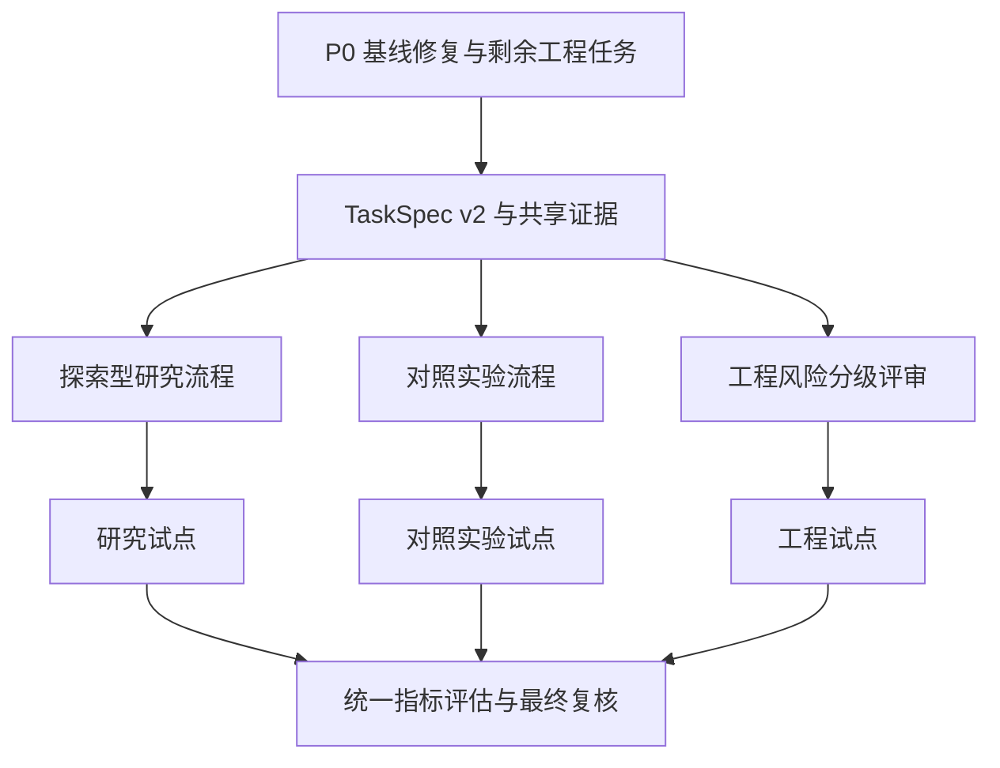

# 工作流类型实施计划

> 版本：v1  
> 日期：2026-11-14  
> 实施目录：`/Users/souler/Documents/daqian/playground/orca-dev-workflow`  
> 基线提交：`8410731`  
> 文档性质：只规定文件边界、输入、输出、接受规则和验证门，不包含实现代码

## 1. 目标

在保留现有 `gov` 治理内核的前提下，完成剩余工程任务，并增加三种交付类型：

1. **探索型研究**：以报告、适配分析或 ADR 为交付物，不要求对照实验，也不要求代码合并。
2. **对照实验**：以假设、基线、变量矩阵、运行回执、指标和采用决定为交付物，不自动合并实验产物。
3. **工程交付**：以任务书、ADR、实施计划、代码差异、测试与评审回执为交付物，按 `riskLevel` 选择一次终审（low）、规格与实现双闸门（medium）或规格评审→实现评审→独立总审（high）后合并；风险覆盖复杂度，simple+high 仍走三段评审链。

三类任务共用认领、环境隔离、身份、证据、操作恢复和资源清理。任务书、状态迁移、验收证据和角色材料按交付类型分别定义，不新建第二套 Agent 系统。

## 2. 基线与约束

### 2.1 已核实基线

- 当前实现已完成 Phase 0–5 的主要工程任务；T6.1–T7.2 尚未完成。
- `src/domain/task-spec.ts` 是严格 `schemaVersion: 1` 的工程任务书，要求 `baseCommitId`、目标和三类验收标准。
- `src/prompts/prompt-set.ts` 当前要求恰好四份角色模板，并计算 `promptSetHash`。
- 最近一次串行执行结果：`test:isolation` 32/32 通过；`test/integration` 在 `test/integration/recovery/recovery.test.ts:646` 失败，错误码为 `E_CLAIM_PREP_FAILED`。确切 `lastError` 和失败阶段必须先核实，不能预设为模型问题。
- Orca 适配器已对近期回执漂移做过兼容修复，但桌面运行时版本仍可能影响真实 worker 启动。
- 桌面 `claude Command` 与 settings 路径问题已由用户修正；最新探针 `run_fc20a8144bf5` 返回 `state=ready`，随后收到 `worker_done`。该探针只证明当前 worker 启动链路可用，不能替代 S3 失败根因诊断。

### 2.2 会话证据的使用边界

输入证据来自仓库内的 `docs/research/session-workflow-evidence.md` 与 `docs/research/model-routing-doctrine.md`：

- 近期样本支持探索型研究与对照实验使用不同验收标准。
- 方案评审和实现评审可以分开，但低风险交付允许一次终审。
- 实验终点是证据包与采用决定，不是自动合并。
- 实际使用以主会话加一层子代理为主，不能据此强制三级 Session。
- `subagent-dev-simple + Opus 终审 + codex impl-mode 终审` 是已观察到的交付路径；deepseek、KIMI、GLM 的固定分工尚未证实，只能作为试点候选。

OpenCode 数据截至 2026-09-17，不能据此判断其后两个月的模型偏好。实验调优曾出现高消息数和高成本，必须设置停止条件。

### 2.3 硬约束

1. 先修复基线测试，再增加工作流类型；不得把环境修复和模型路由修改放在同一变量实验中。
2. 不把任何模型通道写成已验证最优或默认必选。
3. 不为研究或实验强制 `baseCommitId`、bookmark、快进合并或部署。
4. 不把职责角色数量等同于 Session 层数；默认主会话加一层执行或评审 Session，复杂任务才增加独立任务负责人。
5. 不自动 push、创建 MR、部署或修改 GitLab Issue。
6. 不修改 `~/.cenv/` 中的凭据文件，不在日志中记录其内容。
7. 视觉、设备和跨系统结果仍需人工验收，不能由测试或日志自动替代。
8. 不改变现有 v1 工程任务书的读取行为；新版本必须说明迁移和消费者分支行为。

## 3. 目标结构

最终形成以下模块边界：

| 模块 | 责任 |
|---|---|
| 任务书与配置 | 识别交付类型、复杂度、阶段通道和预算 |
| 状态与证据 | 按类型限制状态迁移、记录来源/运行/指标/决策证据 |
| 研究服务 | 生成来源清单、报告或 ADR，并允许在报告后结束 |
| 实验服务 | 锁定实验设计，保存运行回执和独立评测结果 |
| 工程评审 | 按 `riskLevel`（low/medium/high）决定一次终审、规格与实现双闸门、或双闸门加独立总审；`complexity` 只控制提示词深度，风险覆盖复杂度 |
| 模型通道 | 通过绝对路径的 settings 文件选择执行通道，不进入提示词正文 |
| 评估与发布 | 比较成功率、返修、成本、时延和证据完整性，形成采用或暂缓决定 |

## 4. 决策记录

| 编号 | 决策 | 理由 |
|---|---|---|
| D1 | 按交付物而不是按“研究/工程”名称分类 | 工程任务也包含调研，实验也可能产生代码 |
| D2 | 保留一个治理内核，按类型扩展任务书和状态机 | 避免重复建设认领、隔离、恢复和清理 |
| D3 | 研究分探索型和对照实验型 | 报告退出条件与实验指标退出条件不同 |
| D4 | 实验不自动合并，采用后另建工程任务 | 防止研究证据直接变成未审查的工程变更 |
| D5 | 默认两层 Session，复杂任务才增加任务负责人 | 近期样本主要是主会话加一层子代理 |
| D6 | 工程评审按 `riskLevel` 风险分级，风险覆盖复杂度 | low 一次终审；medium 规格评审→实现评审；high 规格评审→实现评审→独立总审；simple+high 仍走三段链，complex+low 不因复杂度加闸门；`complexity` 只控制提示词深度 |
| D7 | 模型路由先做三项试点 | 现有证据不足以证明固定分工 |
| D8 | 先完成 T6.1–T7.2 和当前失败修复 | 防止将环境变量误读为架构或模型问题 |

## 5. 执行波次与文件所有权

真实模型试点全部串行执行，避免供应商配额、桌面 Runtime 和容器资源互相影响。只有明确标记为可并行的文档或单元测试任务才可并行。

| 波次 | 任务 | 可并行 | 退出条件 |
|---|---|---|---|
| W0 | P0.1 | 否 | 当前失败原因有证据，集成与隔离全部通过 |
| W1 | P0.2、P0.3 | 是 | T6.1 一致性、T6.2 预算与通知通过 |
| W2 | P0.4 | 否 | 真实 Agent 试点和 runbook 完成 |
| W3 | P0.5、P0.6 | 否 | Nix 创建、共存与清理通过 |
| W4 | P1.1 | 否 | v2 任务书、迁移、错误码通过 |
| W5 | P1.2 | 否 | 状态与证据模型通过 |
| W6 | P1.3 | 否 | 角色材料、通道注入与哈希通过 |
| W7 | P2.1、P2.2 | 仅实现文件可并行，真实调用串行 | 研究和实验服务通过各自验证 |
| W8 | P2.3 | 否 | 工程风险分级评审通过 |
| W9 | P3.1 | 否 | 探索型研究试点完成 |
| W10 | P3.2 | 否 | 对照实验试点完成 |
| W11 | P3.3 | 否 | 工程试点及合并清理完成 |
| W12 | P3.4 | 否 | 指标评估与路由决定完成 |
| W13 | P3.5 | 否 | 文档、技能和最终复核完成 |

### 文件所有权矩阵

| 任务 | 唯一写入范围 |
|---|---|
| P0.1 | `src/adapters/orca.ts`、`src/services/claims.ts`、`test/integration/recovery/` |
| P0.2 | `test/conformance/`、`package.json` 中的一致性测试脚本 |
| P0.3 | `src/services/budgets.ts`、`src/services/status.ts`、`src/services/claims.ts`、`src/services/reviews.ts`、`src/api.ts`、`test/unit/budgets/` |
| P0.4 | `docs/pilot/`、`runbook.md`、`/Users/souler/yfp/.claude/skills/orca-coord/SKILL.md` |
| P0.5 | `deploy/nix/` |
| P0.6 | `test/isolation/nix/` |
| P1.1 | `src/domain/task-spec.ts`、`src/domain/workflow-spec.ts`、`src/domain/errors.ts`、`src/db/migrations.ts`、`src/services/tasks.ts`、`src/services/workspaces.ts`、`src/api.ts`、`src/services/claims.ts`、`src/server.ts`、`test/unit/domain/` |
| P1.2 | `src/state/workflow-profiles.ts`、`src/services/workflow-state.ts`、`src/services/ports.ts`、`src/domain/evidence.ts`、`src/services/cleanup.ts`、`test/unit/state/` |
| P1.3 | `src/prompts/prompt-set.ts`、`prompts/`、`src/services/model-channels.ts`、`src/config.ts`、`src/services/claims.ts`、`src/services/ports.ts`、`src/adapters/orca.ts`、`test/unit/prompts/`、`test/unit/model-channels/`、`deploy/README.md` |
| P2.1 | `src/services/research.ts`、`src/services/research-evidence.ts`、`src/api.ts`、`test/unit/research/`、`test/integration/research/` |
| P2.2 | `src/services/experiments.ts`、`src/services/judge.ts`、`src/api.ts`、`test/unit/experiments/`、`test/integration/experiments/` |
| P2.3 | `src/services/review-gates.ts`、`src/services/reviews.ts`、`src/services/merges.ts`、`src/services/claims.ts`、`test/unit/review-gates/` |
| P3.1 | `docs/pilots/research/` |
| P3.2 | `docs/pilots/experiment/` |
| P3.3 | `docs/pilots/engineering/` |
| P3.4 | `docs/evaluation/`、`src/services/metrics.ts`、`test/unit/metrics/` |
| P3.5 | `governance-design.md`、`governance-tasks.md`、`workflow-profiles-plan.md`、`governance-review.md`、`governance-review.html`、`docs/research/session-workflow-analysis.md`、`execution/review-package.md` |

`execution/` 只保存执行过程记录，已由忽略规则排除，不作为实现任务的交付源码。任何新错误码统一归 P1.1，其他任务不得新增错误码文件或改写既有错误码语义。

顺序共享文件说明：`claims.ts` 按 P0.3→P1.1→P1.3→P2.1/P2.2→P2.3 顺序执行；`ports.ts` 按 P1.2→P1.3 顺序执行；`api.ts` 按 P0.3→P1.1→P2.1/P2.2 顺序执行；同一文件跨阶段只能在上一波次完成后修改，禁止并行写入。

## 6. Phase 0：基线修复与剩余工程任务

### P0.1 核实并修复当前集成测试失败

- **Files**：修改 `src/adapters/orca.ts`、`src/services/claims.ts`、`test/integration/recovery/`；不得修改业务任务书或模型路由。
- **Inputs**：`recovery.test.ts:630–670` 的 S3 场景、真实 `worker-start` 回执、当前 Orca runtime 版本、`execution/worker-start-readback-fix-report.md`，以及最新 `run_fc20a8144bf5` 的 ready/worker_done 探针记录。
- **Outputs**：失败阶段的实际错误原文、根因分类、最小修复和 S3 回归证据。
- **Accept rule**：区分回执形状变化、工作区配置、信任门和真实行为变化；只修复有证据支持的缺陷；不得用跳过测试或放宽断言掩盖失败。若根因不在本任务文件所有权内，先停下并调整计划，不跨文件修补。
- **Verification gate**：`pnpm check`、`pnpm test:integration`、`pnpm test:isolation` 串行全部通过；S3 的 UNCERTAIN、结算、FENCED 和 retry-of 语义保持不变。

### P0.2 完成 T6.1 全量一致性测试

- **Files**：创建 `test/conformance/`，并在 `package.json` 注册一致性测试命令。
- **Inputs**：设计 §7、§8、§14；T3.1–T5.3 实现；P0.1 修复结果。
- **Outputs**：状态、身份、证据、版本、恢复、隔离和清理的可重复场景集、两轮结果文件和资源基准记录。
- **Accept rule**：所有场景默认执行，无跳过、无首个失败即停止；每个场景独立 rail；失败报告包含任务、操作、外部 ID 和残余资源。
- **Verification gate**：连续两次完整执行结果一致；Orca、jj、Docker、临时目录和数据库记录回到基准；发现的缺陷返回原文件所有者，不在本任务中扩展功能。

### P0.3 完成 T6.2 预算、状态摘要和事件通知

- **Files**：创建 `src/services/budgets.ts`、`src/services/status.ts`、`test/unit/budgets/`；修改 `src/services/claims.ts`、`src/services/reviews.ts`、`src/api.ts`。
- **Inputs**：设计 §11.2、T1.2 事件记录、T5.3 角色配置。
- **Outputs**：活动任务与评审并发限制、状态摘要、阻塞原因、下一步和状态变化通知；任务/评审派发前的准入检查与 handler 接线；`beforeSource` 与 `beforeRun` 预算检查入口及停派结果；`beforeSource`/`beforeRun` 除次数与字节检查外，还检查任务级 wallSeconds 与 run-level 超时，超限进入 PARKED，不自动重试。执行中用量结算与停止：`recordSourceUsage`、`recordRunUsage`、`isBudgetExceeded` 与超时取消回执，覆盖执行中的来源/运行用量，而不只 `beforeSource`/`beforeRun` 派发前检查。
- **Accept rule**：达到预算时等待，不自动换模型；普通进度不通知人；异常包含可执行下一步；构建并发与供应商准入仍按已裁定的延后项处理。每次 claim 或 review workerStart 前必须检查活动任务/评审数；达到两任务一评审时等待，不能只在 status 摘要中显示而不阻断。来源/运行预算耗尽时进入 PARKED 或既定等待态，不产生新的 source/run worker；`beforeSource`/`beforeRun` 预算检查必须能被 P2.1/P2.2 调用，不能只限制 claim/review 总数。`beforeSource`/`beforeRun` 除次数与字节检查外，还须检查任务级 wallSeconds 和 run-level 超时，超限进入 PARKED，不自动重试。
- **Verification gate**：验证两个任务和一个评审上限；模拟供应商 429、消息重复和通知失败，均不改变治理状态。

### P0.4 完成 T6.3 真实 Agent 试点与工作流更新

- **Files**：创建 `docs/pilot/`；修改 `runbook.md` 和 `/Users/souler/yfp/.claude/skills/orca-coord/SKILL.md`。
- **Inputs**：G0–G10 通过证据、一个纯逻辑真实任务、真实 Orca/jj/Docker、OpenCode 开发与 Claude 或 Codex 评审。
- **Outputs**：试点任务书、真实回执、模型与版本、耗时、评审轮数、异常、资源清理记录、经 server API 的 submit、评审动作与 split 路径证据和最终 runbook。
- **Accept rule**：完成直接通过、评审退回后继续、目标移动后重新验收、父子任务和两个并行任务；不使用手工 `task-update`、通用 CLI 或自动 push。试点必须包含至少一次经 server API 的 submit、至少一次评审动作（review-request/review-accept/review-submit 之一）和一次 split 路径；任一动作返回未注册即失败，不得以绕过 API 直接调用服务冒充。
- **Verification gate**：全部结果来自真实 Orca/jj/Docker；runbook 与实际步骤一致；Orca 注册、终端、容器和临时目录清理完成；经 server API 的 submit、评审与 split 证据齐全，未注册路径判失败而非绕过。

### P0.5 完成 T7.1 Nix 环境接入

- **Files**：创建 `deploy/nix/` 及其中环境说明。
- **Inputs**：P0.4 通过的容器环境、Nix 官方 `nix develop` 与 gc root 文档。
- **Outputs**：锁定 flake、create 初始化、任务独立 gc root 和 destroy 清理记录。
- **Accept rule**：Nix 不承担文件权限或资源限制；不执行全局 profile 删除或全局垃圾回收；环境不可用时失败关闭。
- **Verification gate**：全新环境按锁文件启动；同一输入两次工具版本一致；gc root 与任务 ID 一一对应。

### P0.6 完成 T7.2 Nix 双任务验证

- **Files**：创建 `test/isolation/nix/`。
- **Inputs**：P0.5 环境和两个不同任务。
- **Outputs**：共存、缓存、资源限制和单任务删除证据。
- **Accept rule**：删除一个任务只清理其可写环境和 root，不影响另一个任务的工具与依赖。
- **Verification gate**：两个任务同时运行测试，清理其中一个后另一个继续通过；不存在全局 `nix-collect-garbage -d` 调用。

## 7. Phase 1：任务书、状态与通道

### P1.1 实现 TaskSpec v2 与迁移

- **Files**：修改 `src/domain/task-spec.ts`；创建 `src/domain/workflow-spec.ts`；追加 `src/db/migrations.ts`；修改 `src/domain/errors.ts`、`src/services/tasks.ts`、`src/services/workspaces.ts`、`src/api.ts`、`src/services/claims.ts`、`src/server.ts` 和 `test/unit/domain/`。
- **Inputs**：现有 v1 schema、设计 §6、会话证据中的三类交付物。
- **Outputs**：`workType`（`research`/`experiment`/`engineering`）、`complexity`（`simple`/`medium`/`complex`，只控制提示词深度）、`riskLevel`（`low`/`medium`/`high`，engineering 专用，控制工程评审路径，research/experiment 不用 `riskLevel` 决定业务终态）、`stageChannels`、三类 profile-specific spec、v1→v2 迁移和读取分支；`agentPolicy` 继续表示 harness 选择，与 `stageChannels` 的模型 settings 注入分离。消费者分支：`tasks.ts`/`workspaces.ts` 中 v1 的 target/baseCommitId 持久化与 workspace 创建保持不变；research/experiment 使用 runRoot/artifactRoot，不持久化工程 target/baseCommitId，不创建代码 workspace；engineering 保持现状。按 workType 分发的 declare/claim 处理器：复用现有 `declare`/`claim` 动作，不发明新的动作名；research/experiment 使用 `runRoot` 作为工作目录与证据根目录，跳过 `prepareWorkspace` 的代码 workspace 创建，workerStart 以 runRoot 启动；engineering 仍走原代码 workspace。按类型的预算字段与扣减语义：research 为 `maxSources`、`maxSourceBytes`、`maxWallSeconds`，达到来源或时间预算即停止并保留已收集证据；experiment 为 `maxRuns`、`maxConcurrentRuns`、`maxRunSeconds`、`maxWallSeconds`、`maxEvidenceBytes`；`maxWallSeconds` 是任务级墙钟总预算，区别于单次运行的 `maxRunSeconds`，worker 令牌有效期取 `min(maxWallSeconds, 配置上限)`，恢复时继续使用同一有效期，缺失期限不得被解释为永不过期；每次运行前检查，超限停止，不自动重试；v1 的 `maxReviewRounds`/`maxWallSeconds`/`maxEvidenceBytes` 兼容语义保留，engineering 不新增字段。资源语义：`runRoot` 是临时执行目录，必须登记为可销毁清理项；`artifactRoot` 是交付目录，只登记归档与保留状态，不得被普通清理删除；`src/db/migrations.ts` 的清理项类型必须覆盖 runRoot 与 artifactRoot，并区分 destroy 与 retain。server 装配：生产启动时由同一组已创建的 `createOrcaAdapter`、`createJjAdapter`、`createEnvironmentAdapter` 和 trustProvision 构造 `claimDeps`、`reviewDeps` 与 `childrenDeps`，一并传入 `registerCoreHandlers`，不得只创建空注册表，也不得只装配 `claimDeps`；`reviewDeps` 使用现有 `OrcaMessagingPort`、`JjVersionPort`、`EnvLifecyclePort` 及可选 `stepTimeoutMs`，`childrenDeps` 使用现有 `OrcaSettlementPort`、`JjMergePort & JjChildAdvancePort`、`EnvLifecyclePort` 及现有 `trustProvision`/`stepTimeoutMs` 可选配置；不新增第二套服务或适配器层，不改变 `recoveryDeps` 语义。
- **Accept rule**：v1 输入继续按工程语义处理；v2 必填字段按类型校验；v2 engineering 必须显式提供 `riskLevel`，缺失或未知值拒绝，不凭空推断 v1 旧任务的风险等级，只有显式升级 v2 时才要求提供该字段，`riskLevel` 不是模型通道，不改变 `agentPolicy`/harness 语义；研究和实验不要求 `baseCommitId` 或 bookmark；`stageChannels` 只引用已配置通道，不携带凭据；模型默认值不得新增。`agentPolicy` 在 v2 中保留为 harness 选择，v1 的 literal/enum 语义不变，`claims.ts` 的 `workerStart.agent` 来源对 v1/v2 一致，模型只通过 settings 注入切换。`tasks.ts` 与 `workspaces.ts` 必须按 workType 分支处理，不能要求研究/实验携带工程基线。`api.ts` 必须能按 workType 将请求路由到 research/experiment handler；`claims.ts` 必须支持 runRoot 启动而非只接受 hostPath；研究/实验不能直接复用 engineering 的 baseCommit/workspace 前置。预算字段必须进入 v2 schema，来源/运行预算在每次派发前扣减或拒绝，不能只写在文档或状态摘要里。declare、claim、accept、submit、fail、cancel、rebase、review-request、review-accept、review-submit、manual-approve、split 的 handler 在 server 启动后必须已注册并能到达相应 handler，不能因缺少 `claimDeps`/`reviewDeps`/`childrenDeps` 返回 unregistered；单测必须验证 server 装配后这些动作的装配路径。experiment 必须同时支持 run-level 与 task-level 时间预算，`claims.ts` 不得只用 `maxRunSeconds` 或缺失字段签发令牌。
- **Verification gate**：旧任务解析不变；未知字段、错误类型、缺失基线（对照实验）、缺失来源范围（研究）均拒绝；v2 engineering 缺失或未知 `riskLevel` 拒绝；迁移幂等且可回滚。启动装配证据：生产启动后 declare、claim、accept、submit、fail、cancel、rebase、review-request、review-accept、review-submit、manual-approve、split 均注册并可到达相应 handler，单测与启动证据须证明 `reviewDeps`/`childrenDeps` 不是只在类型层出现。

### P1.2 实现按类型分状态机与证据记录

- **Files**：创建 `src/state/workflow-profiles.ts`、`src/services/workflow-state.ts`、`src/domain/evidence.ts`、`src/services/cleanup.ts`；修改 `src/services/ports.ts` 和 `test/unit/state/`。
- **Inputs**：设计 §7、§13；P1.1 profile 类型；现有任务/认领/操作记录。
- **Outputs**：研究状态 `collecting/analyzing/decision_review/done/parked`、实验状态 `design_review/running/benchmarking/report_review/decided/parked`、证据类型 `source/run-receipt/metric/decision`、操作员豁免记录。完整迁移边与终态映射：研究 `DECLARED→COLLECTING→ANALYZING→DECISION_REVIEW→DONE/PARKED`，退回可回 `ANALYZING`，预算耗尽/人工取消到 `PARKED/CANCELLED`；实验 `DECLARED→DESIGN_REVIEW→RUNNING→BENCHMARKING→REPORT_REVIEW→DECIDED/PARKED`，设计退回可回 `DESIGN_REVIEW`，预算内重跑可回 `RUNNING`，预算耗尽到 `PARKED`，取消到 `CANCELLED`。研究和实验的 `DONE`/`DECIDED` 都是业务终态，不走 `MERGED`；完成/取消/中止后均经 archive+cleanup，`cleanup_pending` 可重试，不调用 confirmMerge。runRoot/artifactRoot 的登记、归档、销毁/保留回执。
- **Accept rule**：非法迁移拒绝；研究到工程必须新建工程任务；实验禁止直接 merge；`NOT_READY` 未记录操作员豁免不得继续；外部结果不确定时不自动重试。状态名、迁移边、重试/停止条件和清理动作一一对应；非工程终态不得进入 confirmMerge。runRoot 只有在归档成功后才可删除；artifactRoot 只归档和保留，不得因 confirmMerge 缺失而被删除；归档失败时保留全部目录并进入 cleanup_pending；研究/实验产物不得被当作普通 workspace 清理。
- **Verification gate**：覆盖全部合法边、终态无出边、豁免留痕、证据不可改写、重复恢复不产生重复副作用。

### P1.3 实现角色材料 v2 与模型通道注入

- **Files**：修改 `src/prompts/prompt-set.ts`、`src/config.ts`、`src/services/claims.ts`、`src/services/ports.ts`、`src/adapters/orca.ts`；创建 `prompts/` 下按类型和复杂度划分的材料、`src/services/model-channels.ts`、`test/unit/prompts/`、`test/unit/model-channels/`；修改 `deploy/README.md`。
- **Inputs**：设计 §12、现有四模板装配、模型路由候选、`~/.cenv/` 文件名（不读取内容）。
- **Outputs**：独立的 v2 材料版本标识与 manifest/hash、`prompts/v2/<profile>/<role>-<complexity>.md` 材料、绝对路径 settings 注入和通道回执；v1 根目录四份模板及其 `promptSetHash` 行为不变。真实启动链路：`TaskSpec.stageChannels → 选择并生成 agent Command（claude --settings <绝对路径>）→ claims.workerStart({agent: harness}) → ports/orca.workerStart`；`workerStart` 只接收 harness/agent，settings 通过 agent Command 注入，不进入 `workerStart` 参数；`workerStart.agent` 的 harness 选择不变。
- **Accept rule**：模板不包含模型名、令牌或管理命令教程；hash 只用于材料完整性；注入路径不得使用 `~`；不同角色可使用不同 Session 或新上下文；hook 失效不改变容器权限；v1 根目录四份模板及其解析/哈希行为保持可用，v2 材料必须位于 `prompts/v2/<profile>/` 子目录并使用独立 manifest/hash，未知 profile 失败关闭。启动适配器必须接收并转发 settings 绝对路径，不能用 Agent 传入的 `~`、身份字段或 shell 拼接；必须能用假 Orca 适配器验证 settings 到达启动入口。`workerStart` 只传 harness/agent，不传 `--settings`；settings 通过受支持的 agent Command 或 `claude --settings <绝对路径>` 注入，绝对路径来自已配置通道；若通道不是 Claude settings 文件，按其 harness 支持的配置方式处理，失败关闭。
- **Verification gate**：材料清单与 hash 确定；占位符无残留；通道切换只改变 settings 文件；敏感内容扫描通过；简单/中等/复杂三种模板均能被正确装配。证据：`orca orchestration worker-start --help` 无 `--settings`；`claude --help` 有 `--settings <file-or-json>`；不得把 Orca `--environment` 当作 settings 文件参数（它用于选择配对的 Orca server）。

## 8. Phase 2：三类工作流实现

### P2.1 实现探索型研究流程

- **Files**：创建 `src/services/research.ts`、`src/services/research-evidence.ts`、`test/unit/research/`、`test/integration/research/`；修改 `src/api.ts`。
- **Inputs**：P1.1 研究任务书、P1.2 状态和证据、P1.3 采集与分析通道。
- **Outputs**：来源清单、分主题笔记、报告或 ADR、未知项和采用/继续实验/转工程/搁置决定；handler 注册：研究注册 declare/claim 的研究处理入口。每个来源都有进度检查点、实际来源数/字节数/耗时记录和超时取消路径；单个来源持续输出或卡住时，必须在检查点或超时处停止，保留已完成证据并进入 PARKED，不能无限等待下一次派发；复用现有 `withStepTimeout` 与 operations 回执，不新建第二套恢复机制。
- **Accept rule**：采集只记录来源事实，分析必须能回溯到来源；不以对照实验或代码合并作为必需出口；达到时间或来源预算后必须形成可审阅结果。研究角色的 declare/claim 可经 API 到达研究服务，未注册时明确返回未实现而不是误走工程路径；研究来源派发必须经过 `beforeSource` 预算入口，超额后保留已有证据并按 PARKED 结束；单个来源持续输出或卡住时，必须在检查点或超时处停止，保留已完成证据并进入 PARKED，不能无限等待下一次派发。
- **Verification gate**：报告可不经过实验直接结束；来源与主张可互查；无来源支持的断言标为未知；不发生自动 push、merge 或部署。

### P2.2 实现对照实验与独立评测流程

- **Files**：创建 `src/services/experiments.ts`、`src/services/judge.ts`、`test/unit/experiments/`、`test/integration/experiments/`；修改 `src/api.ts`。
- **Inputs**：实验任务书、基线、变量矩阵、固定输入、指标、样本策略、停止规则、执行与评测通道。
- **Outputs**：锁定实验设计、运行回执、原始输出、评分器结果、分母与失败样本、分析报告和采用决定；handler 注册：实验注册 declare/claim 的实验处理入口。每次运行都有进度检查点、实际运行数/字节数/耗时记录和超时取消路径；单次运行卡住时，必须在检查点或超时处停止，保留已完成证据并进入 PARKED，不能无限等待下一次派发；复用现有 `withStepTimeout` 与 operations 回执，不新建第二套恢复机制。
- **Accept rule**：对照实验必须有基线和预先声明指标；一次只改变一个主要变量；运行中不得修改实验设计；评测与实现分离；实验不自动合并。实验角色的 declare/claim 可经 API 到达实验服务，未注册时明确返回未实现而不是误走工程路径；实验运行派发必须经过 `beforeRun` 预算入口，超额后保留已有证据并按 PARKED 结束；单次运行卡住时，必须在检查点或超时处停止，保留已完成证据并进入 PARKED，不能无限等待下一次派发。
- **Verification gate**：缺基线或指标拒绝启动；原始结果不可改写；分母、缺答、降级和失败样本齐全；独立 judge 输出可复核；达到预算即停止并保留阴性结果。

### P2.3 实现工程风险分级评审与豁免

- **Files**：创建 `src/services/review-gates.ts`；修改 `src/services/reviews.ts`、`src/services/merges.ts`、`src/services/claims.ts`、`test/unit/review-gates/`。
- **Inputs**：现有工程评审与合并流程、`docs/research/codex-double-gate-evidence.md`、v2 engineering 的 `riskLevel` 字段与 `complexity` 字段（`complexity` 只控制提示词深度，评审分支由 `riskLevel` 决定）。
- **Outputs**：`riskLevel` 分级评审策略（low 允许一次终审；medium 必须先规格评审再实现评审；high 必须规格评审→实现评审→独立总审三段链）、实现前规格评审回执与 accept 授权检查、操作员豁免记录和部署人工决定点。规格评审不依赖已有 submission；accept 仅在规格评审通过或存在操作员豁免时允许写权限切换。
- **Accept rule**：评审路径只由 `riskLevel` 决定，风险覆盖复杂度：low 允许一次终审；medium 必须先规格评审再实现评审；high 必须规格评审→实现评审→独立总审。simple+high 不能走单终审，complex+low 也不因复杂度额外增加闸门；规格 NOT-READY 未豁免不得进入实现；评审不替代测试；合并后仍需人工决定部署。既有 `Opus 终审 + Codex impl-mode` 路径保留为对照，KIMI 总审仅作为试点候选，不写成默认要求。规格评审 NOT-READY 或缺失时，`claims.ts` 不得调用 setWritable；豁免必须记录操作者、理由和时间；实现评审仍按原提交评审路径执行。
- **Verification gate**：low 单终审、medium 双闸门、high 三段链路径分别通过；`complexity`×`riskLevel` 交叉矩阵至少覆盖 simple+high（仍走三段评审链）与 complex+low（不因复杂度额外加闸门）两个方向，并验证 high 的独立总审身份与方案评审、实现评审相互独立；豁免可审计；未豁免的 NOT-READY 被阻断；没有自动 push 或部署。

## 9. Phase 3：试点与评估

### P3.1 执行探索型研究试点

- **Files**：创建 `docs/pilots/research/`。
- **Inputs**：一个明确的业界实践调研问题、P2.1 研究流程、GLM 采集通道和 KIMI 分析通道。
- **Outputs**：来源清单、分析报告、适配度/成本/复杂度比较、是否进入实验或工程的决定。
- **Accept rule**：试点可在报告后结束，不强制产生代码或实验；所有关键主张能回指来源；记录未解决问题。
- **Verification gate**：研究产物完整、无自动合并、无自动部署；评审仅检查证据和范围，不将报告文风当作通过条件。

### P3.2 执行对照实验试点

- **Files**：创建 `docs/pilots/experiment/`。
- **Inputs**：同一批明确规格开发任务、deepseek 与 kimi-for-coding 两个候选通道、固定输入和预算、P2.2 实验流程。
- **Outputs**：冻结实验设计、两臂运行回执、自动评测结果、成本/时延/一次通过率/返修轮数/越界率对比和独立评审记录。
- **Accept rule**：同一 case 配对比较，除通道外不改变输入、预算或评分标准；实验设计者与最终评估者分离；不因单次结果指定默认模型。
- **Verification gate**：两臂均有完整分母和失败清单；独立 judge 可重算；Codex 或指定评审通道完成对抗复核；最终结论标明样本量和不确定性。

### P3.3 执行工程交付试点

- **Files**：创建 `docs/pilots/engineering/`。
- **Inputs**：一个已知工程变更及其 `riskLevel` 与 `complexity`、KIMI 方案与拆解、deepseek 实现和测试、Codex 实现评审、独立总审（KIMI 为试点候选，实际以评审配置为准）。
- **Outputs**：ADR、实施计划、实现 diff、测试回执、评审处置、合并回执、清理回执和按 `riskLevel` 执行的完整评审链证据（含 simple+high 的三段评审链）。
- **Accept rule**：评审路径由 `riskLevel` 决定：low 一次终审，medium 先规格评审再实现评审，high 规格评审→实现评审→独立总审；simple+high 仍走三段评审链，不得因复杂度降为单终审；只有评审通过后才允许快进合并；合并不自动转为部署。
- **Verification gate**：全部相关测试通过；评审身份独立；合并目标正确；容器、jj workspace、注册项、终端和临时目录清理完成；simple+high 案例的规格评审→实现评审→独立总审三段评审链证据齐全。

### P3.4 汇总指标并决定路由策略

- **Files**：创建 `docs/evaluation/`、`src/services/metrics.ts`、`test/unit/metrics/`。
- **Inputs**：三个试点的任务书、运行回执、测试结果、评审记录、成本和时延。
- **Outputs**：统一指标表、通道、`complexity` 与 `riskLevel` 对照、采用/暂缓/重复/拒绝决定、后续是否保留双闸门的建议。
- **Accept rule**：同时报告成功率、一次通过率、返修轮数、成本、时延、越界率和证据完整性；保留阴性结果和无效样本；一次只改变一个主要变量。
- **Verification gate**：指标可由原始回执重算；任何默认路由建议都标注证据范围和不确定性；未达样本量或证据不足时只能暂缓，不得宣称最优。

### P3.5 更新文档、技能与最终复核

- **Files**：修改 `governance-design.md`、`governance-tasks.md`、`workflow-profiles-plan.md`、`governance-review.md`、`governance-review.html`；创建 `docs/research/session-workflow-analysis.md` 和 `execution/review-package.md`。
- **Inputs**：P0–P3.4 全部实现与试点证据、现有 runbook、orca-coord skill。
- **Outputs**：工作流类型设计定稿、计划完成状态、会话证据分析、全量 diff 复核包和最终复核结论。
- **Accept rule**：文档与实际接口一致；研究/实验/工程边界一致；旧 v1 行为未被改写；没有未处置的中高严重度问题。
- **Verification gate**：最终独立复核覆盖全部变更；`pnpm check`、`pnpm test:integration`、`pnpm test:isolation`、`pnpm test:conformance` 全部通过；资源计数回到基准。

## 10. 验收门

原有 G0–G12 必须先保持通过。新增门如下：

| 门 | 必须提交的证据 | 对应任务 |
|---|---|---|
| WP-G0 | 当前失败修复完成，集成与隔离全部通过 | P0.1 |
| WP-G1 | T6.1–T7.2 全部完成 | P0.2–P0.6 |
| WP-G2 | v1 兼容、v2 三类任务书和迁移通过 | P1.1 |
| WP-G3 | 状态机、证据类型和 NOT-READY 豁免通过 | P1.2 |
| WP-G4 | 角色材料 v2、通道注入、hash 和敏感扫描通过 | P1.3 |
| WP-G5 | 探索型研究可在报告后结束且证据可追溯 | P2.1、P3.1 |
| WP-G6 | 对照实验基线、单变量、独立评测、分母和阴性结果完整 | P2.2、P3.2 |
| WP-G7 | low 单终审、medium 双闸门、high 双闸门+独立总审（按 `riskLevel`）均可执行，simple+high 仍走三段评审链，豁免可审计 | P2.3、P3.3 |
| WP-G8 | 三项试点完成，模型路由没有未经证实的默认结论 | P3.1–P3.3 |
| WP-G9 | 指标可重算，采用/暂缓决定有证据范围 | P3.4 |
| WP-G10 | 全部测试、资源清理、文档和最终复核通过 | P3.5 |

## 11. 开工与交付检查

### 开工前

- [ ] P0.1 已核实真实 `lastError`，没有把失败归因于模型。
- [ ] 每个波次的文件所有权无交集；真实模型试点串行。
- [ ] 所有临时仓库、Run、容器和凭据均为测试专用。
- [ ] 已记录桌面 Command 与 settings 绝对路径修复及 `run_fc20a8144bf5` 的 ready/worker_done 回执；若配置再次变化先暂停并复核。
- [ ] 需要真实模型的试点已获用户确认。
- [ ] v1 任务书、现有评审和合并行为不会被静默改变。

### 交付前

- [ ] `pnpm check`、`pnpm test:integration`、`pnpm test:isolation`、`pnpm test:conformance` 全部执行并通过。
- [ ] 原 G0–G12 与 WP-G0–WP-G10 证据齐全。
- [ ] 研究和实验没有自动合并或部署；工程合并有独立评审和版本回执。
- [ ] 工程交付的评审链与任务书 `riskLevel` 一致：low 一次终审、medium 规格+实现双闸门、high 另加独立总审；simple+high 未降为单终审，complex+low 未因复杂度额外加闸门。
- [ ] 没有凭据、完整环境变量或不必要的模型输出进入日志。
- [ ] 没有遗留 Agent、容器、jj workspace、注册项、终端、临时目录或未说明的外部副作用。
- [ ] 评审、评估、总审身份和 Session 边界清晰，没有自我签核。
- [ ] 最终复核确认没有未处置的中高严重度问题，或已明确列出并交由用户决定。
